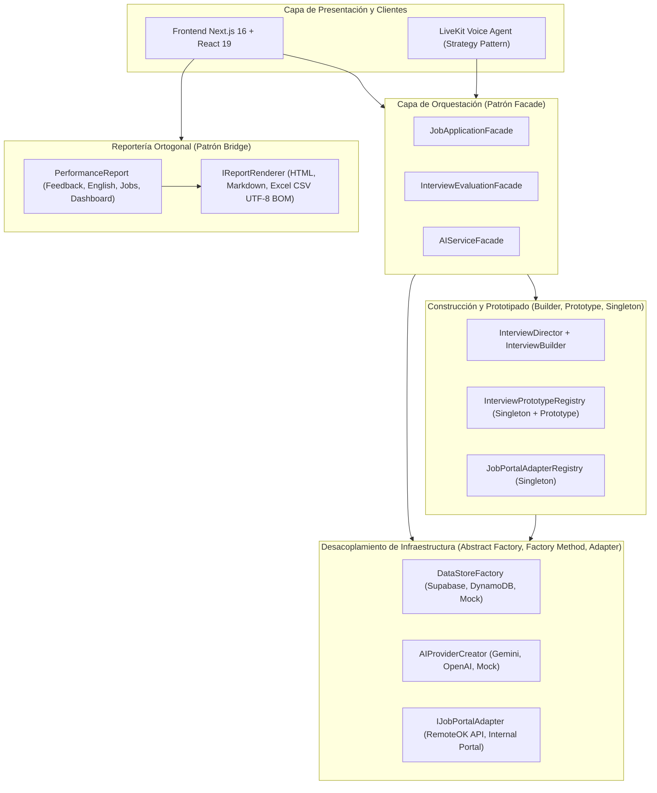

# 🎓 Documentación de Base Investigativa para Proyecto de Grado: **DevCareer AI**

> **Propósito del Documento:** Este documento estructura y sintetiza el proyecto **DevCareer AI** desde una perspectiva **científica, metodológica y de ingeniería de software**, sirviendo como insumo base para la formulación de un **Anteproyecto o Trabajo de Grado** (Pregrado en Ingeniería de Sistemas/Software o Especialización/Maestría en Ingeniería de Software e Inteligencia Artificial).

---

## 1. Propuestas de Título para el Proyecto de Grado

Dependiendo del énfasis académico que se desee priorizar ante el comité curricular, se proponen tres líneas de titulación formal:

1. **Enfoque en Inteligencia Artificial Multimodal y Sistemas Interactivos (Recomendado):**
   > *"Desarrollo de una Plataforma Inteligente Basada en Agentes Conversacionales de Voz en Tiempo Real y Modelos de Lenguaje Multimodales para el Entrenamiento y Evaluación de Competencias en Procesos de Selección de Ingeniería de Software"*
2. **Enfoque en Arquitectura de Software y Diseño de Sistemas Distribuidos:**
   > *"Diseño e Implementación de una Arquitectura Limpia y Políglota Basada en Patrones de Diseño GoF para la Orquestación de Servicios de Inteligencia Artificial Generativa y Comunicación WebRTC en Preparación Técnica Laboral"*
3. **Enfoque en Educación en Ingeniería (EdTech) y Empleabilidad TI:**
   > *"Sistema Integral Asistido por Inteligencia Artificial para el Fortalecimiento de la Empleabilidad Global y Evaluación Automatizada de Habilidades Técnicas, Algorítmicas y Comunicativas en Desarrolladores de Software"*

---

## 2. Clasificación en Líneas y Áreas de Investigación

El proyecto se sitúa en la intersección de tres áreas de investigación reconocidas por estándares internacionales (**ACM Computing Classification System - CCS**, **IEEE** y **Minciencias**):

| Área Principal | Sublínea de Investigación | Aplicación Concreta en DevCareer AI |
| :--- | :--- | :--- |
| **Inteligencia Artificial y Procesamiento del Lenguaje Natural (NLP)** | • Sistemas de Diálogo Hablado (*Spoken Dialogue Systems*) • Grandes Modelos de Lenguaje (*LLMs*) Multimodales • Evaluación Automatizada (*Automated Assessment*) | Pipeline en cascada de baja latencia (`Silero VAD` $\rightarrow$ `Deepgram STT` $\rightarrow$ `Groq LLM` $\rightarrow$ `Cartesia TTS`), análisis multimodal de documentos PDF y calificación semántica bajo el marco MCER (A1–C2). |
| **Ingeniería de Software y Arquitectura de Sistemas** | • Arquitecturas Limpias y Desacopladas • Patrones de Diseño de Software (*GoF*) • Computación *Cloud-Native* e Infraestructura como Código (*IaC*) | Aplicación rigurosa de principios SOLID y 9 patrones de diseño (Abstract Factory, Factory Method, Builder, Prototype, Singleton, Bridge, Facade, Adapter, Strategy) junto con despliegue reproducible en AWS mediante Terraform. |
| **Tecnologías Aplicadas a la Educación (EdTech) y Gestión del Talento TI** | • Simuladores de Entrenamiento Profesional • Sistemas de Seguimiento de Candidatos (*ATS*) • Jueces en Línea y Análisis Algorítmico | Simulación realista de entrevistas técnicas/conductuales, optimización de hojas de vida bajo criterios ATS (metodología STAR/CAR) y evaluación de complejidad asintótica ($\mathcal{O}$ temporal y espacial). |

---

## 3. Planteamiento y Formulación del Problema

### 3.1. Contexto y Descripción de la Problemática
La industria global del desarrollo de software ha experimentado una transformación profunda en sus procesos de reclutamiento y selección técnica. Actualmente, los profesionales y recién graduados de programas de Ingeniería de Sistemas y Computación se enfrentan a un embudo de contratación altamente competitivo y automatizado compuesto por cuatro barreras críticas:

1. **Filtrado Algorítmico Temprano (Sistemas ATS):** Más del 75% de las hojas de vida son descartadas automáticamente por *Applicant Tracking Systems* antes de ser leídas por un reclutador humano, debido a deficiencias en la estructuración semántica, ausencia de palabras clave técnicas (*keywords*) o redacción débil de logros sin métricas de impacto.
2. **Ansiedad y Falta de Práctica en Entrevistas Sincrónicas:** Las entrevistas técnicas y conductuales en vivo exigen articular conceptos complejos de arquitectura y resolución de problemas bajo presión de tiempo. Los candidatos carecen de entornos de simulación realistas con retroalimentación inmediata y objetiva.
3. **Evaluación de Algoritmos y Complejidad Computacional:** Las pruebas de codificación en vivo (*Live Coding*) no solo evalúan que el código funcione, sino su eficiencia asintótica en tiempo y espacio (notación $\mathcal{O}$ de Big-O) y la calidad del código limpio (*Clean Code*), aspectos donde la retroalimentación tradicional suele ser binaria (pasa/falla) y poco pedagógica.
4. **Barrera Idiomática en el Mercado Remoto Internacional:** El acceso a vacantes remotas globales exige competencia comunicativa en inglés técnico (niveles B2–C1 del Marco Común Europeo de Referencia - MCER), pero las herramientas de idiomas convencionales no evalúan el desempeño lingüístico dentro del contexto de una entrevista de ingeniería de software.

Desde la perspectiva de la **Ingeniería de Software**, construir una plataforma que integre voz en tiempo real, múltiples modelos de IA generativa y persistencia en la nube plantea un problema técnico severo: **el acoplamiento tecnológico (*Vendor Lock-in*), la latencia conversacional y la degradación arquitectónica**. Los sistemas tradicionales suelen acoplarse rígidamente a un único proveedor de IA o base de datos, impidiendo la conmutación ante caídas de servicio, dificultando las pruebas automatizadas sin costos de API y generando explosiones combinatorias de clases al escalar funcionalidades.

### 3.2. Formulación del Problema (Pregunta de Investigación)
> **Pregunta Principal:**  
> *¿Cómo diseñar e implementar una plataforma de software con arquitectura desacoplada que integre agentes conversacionales de voz de baja latencia y modelos de inteligencia artificial multimodal para entrenar, evaluar y optimizar de forma integral el desempeño técnico, algorítmico y comunicativo de desarrolladores de software en procesos de selección laboral?*

### 3.3. Sistematización del Problema (Subpreguntas de Investigación)
1. ¿Qué arquitectura de comunicación en tiempo real y pipeline de procesamiento de voz (VAD, STT, LLM, TTS) permite alcanzar una latencia conversacional natural para simular entrevistas técnicas interactivas bilingües?
2. ¿Cómo estructurar la arquitectura del backend mediante patrones de diseño GoF y principios SOLID para garantizar la interoperabilidad en caliente entre múltiples proveedores de IA (Google Gemini, OpenAI, Groq), motores de persistencia (PostgreSQL/Supabase, AWS DynamoDB) y portales de empleo externos?
3. ¿De qué manera los modelos de lenguaje multimodales pueden cuantificar objetivamente la compatibilidad de un currículum frente a filtros ATS, la complejidad algorítmica de soluciones de código y el nivel de competencia en inglés técnico según el estándar MCER?

---

## 4. Justificación de la Investigación

* **Justificación Teórica y Arquitectónica:** El proyecto aporta un caso de estudio empírico sobre cómo mitigar la deuda técnica y el acoplamiento en sistemas intensivos en Inteligencia Artificial Generativa. Demuestra matemáticamente y en código cómo patrones estructurales como **Bridge** reducen la complejidad de crecimiento de $\mathcal{O}(M \times N)$ a $\mathcal{O}(M + N)$ en sistemas de reportería, y cómo **Abstract Factory** y **Factory Method** permiten arquitecturas agnósticas de proveedor (*Vendor-Agnostic AI Architecture*).
* **Justificación Práctica y Tecnológica:** Resuelve la fragmentación de herramientas de preparación laboral. Mientras el mercado actual ofrece plataformas aisladas (unas solo para retos de código como LeetCode, otras solo para escaneo de CV como Jobscan, y otras de chat de texto), **DevCareer AI** unifica en un solo ecosistema WebRTC + IA Multimodal las cinco etapas del ciclo de contratación: búsqueda de vacantes, adaptación de CV, filtrado ATS, prueba de código y entrevista hablada en vivo.
* **Justificación Metodológica:** Establece un flujo de evaluación automatizada basado en rúbricas multidimensionales estructuradas (esquemas JSON validados) que transforman salidas probabilísticas de LLMs en métricas deterministas y trazables para el usuario.
* **Justificación Social y Económica:** Democratiza el acceso a mentoría técnica y preparación de alto nivel para estudiantes universitarios y desarrolladores en Latinoamérica, reduciendo la brecha de inserción laboral hacia empresas tecnológicas locales e internacionales sin los altos costos de entrenadores humanos (*career coaches*).

---

## 5. Objetivos del Proyecto de Grado

### 5.1. Objetivo General
Desarrollar una plataforma web *Full-Stack* basada en una arquitectura limpia de patrones de diseño GoF, agentes conversacionales de voz en tiempo real y modelos de lenguaje multimodales, para el entrenamiento integral y evaluación automatizada de desarrolladores de software frente a procesos de selección en la industria tecnológica.

### 5.2. Objetivos Específicos
1. **Diagnosticar y especificar** los requerimientos funcionales, no funcionales y las rúbricas de evaluación técnica, algorítmica, documental (ATS) y lingüística (MCER) presentes en los procesos modernos de contratación de ingeniería de software.
2. **Diseñar e implementar** una arquitectura de software modular fundamentada en principios SOLID y patrones de diseño creacionales, estructurales y de comportamiento (GoF) que desacople la lógica de dominio de los proveedores de IA, motores de bases de datos y servicios externos.
3. **Construir** un agente conversacional de voz bidireccional en tiempo real sobre protocolo WebRTC, integrando detección de actividad vocal (VAD), transcripción automática (STT), inferencia de lenguaje de ultra-baja latencia (LLM) y síntesis neuronal de voz (TTS) con soporte bilingüe (español e inglés).
4. **Desarrollar** los módulos de evaluación inteligente multimodal para el análisis y optimización de hojas de vida bajo estándares ATS, la calificación de retos de programación (complejidad temporal/espacial Big-O) y la generación de informes multidimensionales post-entrevista.
5. **Validar** la calidad arquitectónica, el rendimiento funcional y la interoperabilidad del sistema mediante suites de pruebas automatizadas aisladas (Mocks), pruebas de integración multi-entorno y aprovisionamiento de infraestructura como código (IaC) en la nube.

---

## 6. Marco Teórico y Estado del Arte (Fundamentación Científica)

Para la redacción del capítulo de **Marco Referencial** del documento de grado, el proyecto se sustenta en cuatro pilares teóricos verificables en la implementación actual del repositorio:

### 6.1. Sistemas Conversacionales de Voz en Cascada de Baja Latencia
A diferencia de las interacciones basadas en texto, la conversación humana fluida exige tiempos de respuesta inferiores a $800\text{ ms}$ para evitar silencios artificiales o solapamientos. En [livekit-agent/agent.ts](file:///c:/Users/JhonM/OneDrive/Documentos/patrones%20de%20dise%C3%B1o%20de%20software/1er%20corte/parcial/DevCareer-AI-PATRONES/livekit-agent/agent.ts), DevCareer AI implementa una arquitectura de transmisión continua (*Streaming Pipeline*) sobre **WebRTC** (mediante **LiveKit**):

$$\text{Audio Entrada (PCM)} \xrightarrow{\text{Silero VAD}} \text{Segmentación} \xrightarrow{\text{Deepgram Nova-2}} \text{Texto (STT)} \xrightarrow{\text{Groq LPU}} \text{Tokens (LLM)} \xrightarrow{\text{Cartesia Sonic-2}} \text{Audio Salida (TTS)}$$

* **Detección de Actividad de Voz (Silero VAD):** Identifica con precisión milimétrica cuándo el candidato inicia o termina de hablar, permitiendo gestionar interrupciones (*barge-in*) de forma natural.
* **Reconocimiento Automático del Habla (Deepgram Nova-2):** Transcribe el flujo de audio en tiempo real tanto en español como en inglés técnico.
* **Inferencia en Unidades de Procesamiento de Lenguaje (Groq):** Ejecuta modelos abiertos de gran escala (LLaMA 3.3 70B / Qwen) a velocidades superiores a $300\text{ tokens/s}$, reduciendo drásticamente el *Time-To-First-Token* (TTFT).
* **Síntesis de Voz Neuronal (Cartesia Sonic-2):** Convierte los fragmentos de texto generados en audio `pcm_s16le` a $16\text{ kHz}$ en streaming antes de que el LLM termine de generar el párrafo completo.
* **Patrón Strategy en el Agente ([voice-agent.strategy.ts](file:///c:/Users/JhonM/OneDrive/Documentos/patrones%20de%20dise%C3%B1o%20de%20software/1er%20corte/parcial/DevCareer-AI-PATRONES/livekit-agent/strategies/voice-agent.strategy.ts)):** Polimorfismo aplicado para conmutar dinámicamente el idioma, el timbre vocal, las preguntas de respaldo y la ingeniería de prompts del sistema sin condicionales rígidos.

### 6.2. Ingeniería de Prompts Estructurada y Evaluación Multimodal
El sistema utiliza modelos fundacionales (Google Gemini Flash y OpenAI GPT-4o) no como simples generadores de texto libre, sino como **motores de evaluación determinista con salida JSON tipada**:
* **Evaluación de Entrevistas ([interview-evaluation.service.ts](file:///c:/Users/JhonM/OneDrive/Documentos/patrones%20de%20dise%C3%B1o%20de%20software/1er%20corte/parcial/DevCareer-AI-PATRONES/Backend/src/services/ai/interview-evaluation.service.ts)):** Analiza la transcripción dialógica calificando de $0$ a $100$ cinco dimensiones: *Comunicación*, *Conocimiento Técnico*, *Resolución de Problemas*, *Ajuste Cultural* y *Confianza/Claridad*.
* **Diagnóstico Lingüístico MCER ([english-proficiency.service.ts](file:///c:/Users/JhonM/OneDrive/Documentos/patrones%20de%20dise%C3%B1o%20de%20software/1er%20corte/parcial/DevCareer-AI-PATRONES/Backend/src/services/ai/english-proficiency.service.ts)):** Evalúa transcripciones en inglés clasificándolas en los niveles **A1, A2, B1, B2, C1 o C2**, extrayendo correcciones gramaticales exactas y sugerencias de vocabulario de ingeniería.
* **Análisis Multimodal ATS ([cv-analysis.service.ts](file:///c:/Users/JhonM/OneDrive/Documentos/patrones%20de%20dise%C3%B1o%20de%20software/1er%20corte/parcial/DevCareer-AI-PATRONES/Backend/src/services/ai/cv-analysis.service.ts)):** Procesa documentos PDF de forma nativa para calcular la intersección léxica y semántica entre las competencias del candidato y los requisitos de una oferta laboral, aplicando la metodología **STAR/CAR** (*Situation/Context, Task, Action, Result*) en [cv-optimization.service.ts](file:///c:/Users/JhonM/OneDrive/Documentos/patrones%20de%20dise%C3%B1o%20de%20software/1er%20corte/parcial/DevCareer-AI-PATRONES/Backend/src/services/cv-optimization.service.ts).
* **Análisis Estático y Semántico de Código ([code-challenge.service.ts](file:///c:/Users/JhonM/OneDrive/Documentos/patrones%20de%20dise%C3%B1o%20de%20software/1er%20corte/parcial/DevCareer-AI-PATRONES/Backend/src/services/ai/code-challenge.service.ts)):** Inspecciona el Árbol de Sintaxis y la lógica del código enviado desde **Monaco Editor**, estimando la complejidad temporal $\mathcal{O}(T)$ y espacial $\mathcal{O}(S)$ y proponiendo refactorizaciones óptimas.

### 6.3. Ingeniería de Software Avanzada: Catálogo de Patrones GoF y SOLID
Un aporte diferenciador de **DevCareer AI** para un trabajo de grado en Ingeniería de Sistemas/Software es su rigor arquitectónico. El backend ([Backend/src/patterns/index.ts](file:///c:/Users/JhonM/OneDrive/Documentos/patrones%20de%20dise%C3%B1o%20de%20software/1er%20corte/parcial/DevCareer-AI-PATRONES/Backend/src/patterns/index.ts)) implementa formalmente **8 patrones GoF en el servidor REST + 1 patrón GoF en el worker de voz**:

1. **Abstract Factory ([datastore.factory.ts](file:///c:/Users/JhonM/OneDrive/Documentos/patrones%20de%20dise%C3%B1o%20de%20software/1er%20corte/parcial/DevCareer-AI-PATRONES/Backend/src/repositories/factories/datastore.factory.ts)):** Permite persistencia políglota intercambiable en tiempo de ejecución entre un motor relacional (**PostgreSQL en Supabase**), un motor NoSQL clave-documento serverless (**AWS DynamoDB**) y un motor en memoria (**Mock**) para pruebas de integración ultrarrápidas.
2. **Factory Method ([ai-provider.creator.ts](file:///c:/Users/JhonM/OneDrive/Documentos/patrones%20de%20dise%C3%B1o%20de%20software/1er%20corte/parcial/DevCareer-AI-PATRONES/Backend/src/services/ai/creators/ai-provider.creator.ts)):** Desacopla la instanciación de proveedores de IA (`GeminiProviderCreator`, `OpenAIProviderCreator`, `MockAIProviderCreator`).
3. **Builder ([interview.builder.ts](file:///c:/Users/JhonM/OneDrive/Documentos/patrones%20de%20dise%C3%B1o%20de%20software/1er%20corte/parcial/DevCareer-AI-PATRONES/Backend/src/patterns/builder/interview.builder.ts) y [interview.director.ts](file:///c:/Users/JhonM/OneDrive/Documentos/patrones%20de%20dise%C3%B1o%20de%20software/1er%20corte/parcial/DevCareer-AI-PATRONES/Backend/src/patterns/builder/interview.director.ts)):** Resuelve la construcción fluida paso a paso de entrevistas personalizadas con validación de invariantes de dominio y recetas dirigidas (borradores, entrevistas técnicas completas o entrevistas derivadas de una oferta laboral).
4. **Prototype ([interview.prototype.ts](file:///c:/Users/JhonM/OneDrive/Documentos/patrones%20de%20dise%C3%B1o%20de%20software/1er%20corte/parcial/DevCareer-AI-PATRONES/Backend/src/patterns/prototype/interview.prototype.ts)):** Permite la clonación profunda en memoria (`clone()`) de plantillas arquetípicas de entrevistas (ej. *Frontend Senior*, *Backend Cloud*) y el reintento de entrevistas históricas sin re-invocar al LLM ni mutar referencias compartidas.
5. **Singleton ([interview-prototype.registry.ts](file:///c:/Users/JhonM/OneDrive/Documentos/patrones%20de%20dise%C3%B1o%20de%20software/1er%20corte/parcial/DevCareer-AI-PATRONES/Backend/src/patterns/prototype/interview-prototype.registry.ts) y [job-portal-adapter.registry.ts](file:///c:/Users/JhonM/OneDrive/Documentos/patrones%20de%20dise%C3%B1o%20de%20software/1er%20corte/parcial/DevCareer-AI-PATRONES/Backend/src/patterns/adapter/job-portal-adapter.registry.ts)):** Garantiza una instancia única en memoria para los registros de prototipos y adaptadores de portales de empleo.
6. **Bridge ([performance-report.abstraction.ts](file:///c:/Users/JhonM/OneDrive/Documentos/patrones%20de%20dise%C3%B1o%20de%20software/1er%20corte/parcial/DevCareer-AI-PATRONES/Backend/src/patterns/bridge/performance-report.abstraction.ts)):** Separa ortogonalmente la jerarquía de abstracción de reportes (`InterviewFeedbackReport`, `EnglishProficiencyReport`, `JobApplicationsReport`, `UserDashboardReport`) de su implementación de formato (`HtmlRenderer`, `MarkdownRenderer`, `ExcelRenderer`, `PlainTextRenderer`).
7. **Facade ([job-application.facade.ts](file:///c:/Users/JhonM/OneDrive/Documentos/patrones%20de%20dise%C3%B1o%20de%20software/1er%20corte/parcial/DevCareer-AI-PATRONES/Backend/src/patterns/facade/job-application.facade.ts) e [interview-evaluation.facade.ts](file:///c:/Users/JhonM/OneDrive/Documentos/patrones%20de%20dise%C3%B1o%20de%20software/1er%20corte/parcial/DevCareer-AI-PATRONES/Backend/src/patterns/facade/interview-evaluation.facade.ts)):** Encapsula flujos de negocio multi-etapa (generación de *Cover Letter* con IA, optimización de resumen ATS, creación de entrevista simulada con Builder y registro en base de datos) en una única operación de alto nivel, erradicando el antipatrón *Fat Controller*.
8. **Adapter ([remote-ok-job.adapter.ts](file:///c:/Users/JhonM/OneDrive/Documentos/patrones%20de%20dise%C3%B1o%20de%20software/1er%20corte/parcial/DevCareer-AI-PATRONES/Backend/src/patterns/adapter/remote-ok-job.adapter.ts), [gemini.adapter.ts](file:///c:/Users/JhonM/OneDrive/Documentos/patrones%20de%20dise%C3%B1o%20de%20software/1er%20corte/parcial/DevCareer-AI-PATRONES/Backend/src/services/ai/gemini.adapter.ts), [openai.adapter.ts](file:///c:/Users/JhonM/OneDrive/Documentos/patrones%20de%20dise%C3%B1o%20de%20software/1er%20corte/parcial/DevCareer-AI-PATRONES/Backend/src/services/ai/openai.adapter.ts)):** Normaliza contratos incompatibles tanto de APIs externas de empleos (como RemoteOK) hacia el modelo de dominio `JobOffer`, como de los SDKs dispares de `@google/genai` y `openai` hacia la interfaz `IAIProvider`.

### 6.4. Infraestructura como Código (IaC) y Despliegue Cloud-Native
El proyecto incorpora un modelo de despliegue reproducible mediante **Terraform** ([terraform-aws/](file:///c:/Users/JhonM/OneDrive/Documentos/patrones%20de%20dise%C3%B1o%20de%20software/1er%20corte/parcial/DevCareer-AI-PATRONES/terraform-aws)) sobre **Amazon Web Services (AWS)**, contemplando:
* Red privada virtual (**AWS VPC**) con subredes públicas y privadas en múltiples zonas de disponibilidad.
* Orquestación de contenedores sin servidor mediante **AWS ECS Fargate** (para la API Express y el Worker de LiveKit) balanceados por un **Application Load Balancer (ALB)**.
* Persistencia NoSQL de baja latencia en **Amazon DynamoDB** y gestión de identidad federada mediante **Amazon Cognito User Pools**.

---

## 7. Diseño Metodológico para el Documento de Grado

### 7.1. Tipo y Enfoque de Investigación
* **Tipo de Investigación:** **Investigación Aplicada y de Desarrollo Tecnológico (I+D+i)**, dado que utiliza fundamentos científicos de inteligencia artificial, procesamiento de voz e ingeniería de software para resolver un problema práctico mediante un artefacto tecnológico funcional.
* **Enfoque Metodológico:** **Cuantitativo / Mixto con diseño Cuasi-Experimental**, evaluando tanto métricas objetivas de ingeniería de software (latencia, desacoplamiento, cobertura de pruebas) como el impacto en el rendimiento de los usuarios.

### 7.2. Metodología de Ingeniería de Software
Para el ciclo de vida del desarrollo se sugiere reportar una metodología **Ágil Iterativa e Incremental (basada en Scrum / XP)** estructurada en 4 fases alineadas con los objetivos específicos:
1. **Fase 1 — Concepción y Especificación Analítica:** Levantamiento de historias de usuario, definición de criterios ATS/MCER y modelado de dominio.
2. **Fase 2 — Diseño Arquitectónico y Refactorización Basada en Patrones:** Transición de una estructura monolítica acoplada hacia una **Clean Architecture** gobernada por principios SOLID y patrones GoF.
3. **Fase 3 — Implementación de Subsistemas e Integración de IA/WebRTC:** Construcción del frontend en Next.js 16, API REST en Express, worker de voz en LiveKit y módulos de análisis con Gemini/OpenAI.
4. **Fase 4 — Verificación Automatizada, Despliegue IaC y Validación Experimental:** Ejecución de suites de prueba unitarias/integración y despliegue en la nube.

---

## 8. Variables, Métricas e Indicadores de Validación (Para el Capítulo de Resultados)

Un proyecto de grado sólido requiere indicadores cuantificables. A continuación se detallan las métricas técnicas y funcionales que ya están respaldadas por el proyecto o que pueden medirse durante la fase experimental:

### 8.1. Métricas de Calidad Arquitectónica e Ingeniería de Software
| Variable Evaluada | Indicador / Fórmula | Resultado en DevCareer AI |
| :--- | :--- | :--- |
| **Reducción de Explosión de Clases (Patrón Bridge)** | Comparación entre diseño por herencia ($M \times N$) vs. diseño por composición Bridge ($M + N$) para $M=4$ reportes y $N=4$ renderizadores. | Reducción de $16$ clases acopladas a $8$ clases independientes ($50\%$ de ahorro estructural y cumplimiento total de OCP). |
| **Ejecución de Pruebas sin Dependencia de Red/API** | Porcentaje de casos de prueba de arquitectura ejecutables en modo *Offline* mediante `MockDataStoreFactory` y `MockAIProviderCreator`. | $100\%$ de las pruebas de patrones ejecutables en $< 2\text{ segundos}$ con costo $\$0.00\text{ USD}$ en tokens de IA. |
| **Interoperabilidad de Persistencia y Modelos** | Número de líneas de código de negocio modificadas para conmutar entre Supabase $\leftrightarrow$ DynamoDB o Gemini $\leftrightarrow$ OpenAI. | $0$ líneas modificadas en la capa de servicios/controladores (conmutación controlada exclusivamente por variables de entorno `DATA_STORE` y `AI_PROVIDER`). |
| **Latencia del Pipeline Conversacional de Voz** | Tiempo de respuesta percibido ($\text{VAD} + \text{STT} + \text{LLM TTFT} + \text{TTS First Byte}$). | Latencia inferior a $1\text{ segundo}$ gracias al transporte WebRTC (LiveKit), inferencia en LPU (Groq) y síntesis streaming PCM (Cartesia). |

### 8.2. Métricas de Impacto Funcional (Propuesta de Validación con Usuarios)
Para enriquecer el trabajo de grado con una prueba piloto (por ejemplo, con $15$ a $30$ estudiantes de últimos semestres de Ingeniería de Sistemas):
1. **Índice de Optimización ATS Pre-Test vs. Post-Test:** Medir el puntaje ATS ($0\text{–}100$) del CV inicial del estudiante en el módulo *CV Analyzer*, aplicar las mejoras asistidas por el *CV Creator* (metodología STAR/CAR) y volver a medir el puntaje ATS, demostrando el incremento porcentual promedio ($\Delta\text{ATS}$).
2. **Evolución del Desempeño en Entrevistas Simuladas:** Comparar la calificación global ($0\text{–}100$) obtenida por los participantes en su primera entrevista simulada frente a su tercera entrevista tras revisar el reporte de retroalimentación de IA.
3. **Escala de Usabilidad del Sistema (SUS - *System Usability Scale*):** Aplicar el cuestionario estándar de 10 ítems de John Brooke a los usuarios tras utilizar los 5 módulos de la plataforma (meta: puntaje $\text{SUS} > 80$, categoría *Excelente*).

---

## 9. Estructura Sugerida de Capítulos para el Documento de Proyecto de Grado

Puedes utilizar este esquema capitular directamente en tu documento institucional (Word / LaTeX):

* **Capítulo 1: Preliminares y Problema de Investigación**
  * 1.1 Planteamiento y Descripción del Problema
  * 1.2 Formulación y Sistematización del Problema
  * 1.3 Justificación (Teórica, Tecnológica, Metodológica y Social)
  * 1.4 Objetivos (General y Específicos)
  * 1.5 Delimitación (Espacial, Temporal y Conceptual)
* **Capítulo 2: Marco Referencial**
  * 2.1 Estado del Arte (Antecedentes internacionales, nacionales y locales sobre simuladores de entrevistas con IA, herramientas ATS y jueces de código)
  * 2.2 Marco Teórico (Arquitectura Limpia, Principios SOLID, Catálogo de Patrones GoF, Procesamiento de Voz en Tiempo Real WebRTC/STT/TTS, Modelos Fundacionales Multimodales, Estándar MCER y Notación Asintótica Big-O)
  * 2.3 Marco Conceptual y Legal (Protección de datos personales en grabaciones y documentos, Ley 1581 de 2012 en Colombia / GDPR)
* **Capítulo 3: Diseño Metodológico**
  * 3.1 Tipo y Diseño de la Investigación
  * 3.2 Metodología de Desarrollo de Software (Fases e Iteraciones)
  * 3.3 Población, Muestra e Instrumentos de Recolección de Datos
* **Capítulo 4: Ingeniería y Arquitectura del Sistema (Desarrollo)**
  * 4.1 Especificación de Requerimientos y Casos de Uso
  * 4.2 Arquitectura General Distribuida (Frontend Next.js, Backend Express, LiveKit Agent, AWS/Supabase)
  * 4.3 Diseño Detallado de Patrones de Diseño GoF Implementados (Diagramas de Clases UML de Abstract Factory, Factory Method, Builder, Prototype, Singleton, Bridge, Facade, Adapter y Strategy)
  * 4.4 Diseño del Pipeline de Inteligencia Artificial y Voz en Tiempo Real
  * 4.5 Infraestructura como Código (Terraform en AWS)
* **Capítulo 5: Pruebas, Resultados y Discusión**
  * 5.1 Verificación Automatizada de Patrones y Desacoplamiento
  * 5.2 Pruebas de Rendimiento del Agente de Voz y Evaluadores Multimodales
  * 5.3 Evaluación de Impacto en Usuarios y Usabilidad (SUS)
  * 5.4 Discusión de Resultados frente a los Objetivos
* **Capítulo 6: Conclusiones, Recomendaciones y Trabajo Futuro**
  * 6.1 Conclusiones
  * 6.2 Trabajo Futuro (ej. análisis de lenguaje corporal por video en WebRTC, integración con LinkedIn API, soporte multi-lenguaje de ejecución en contenedores aislados para retos de código)

---

## 10. Referencias Bibliográficas Clave para Sustentar el Documento (Formato IEEE / APA)

1. **Patrones de Diseño (GoF):** E. Gamma, R. Helm, R. Johnson, and J. Vlissides, *Design Patterns: Elements of Reusable Object-Oriented Software*. Reading, MA, USA: Addison-Wesley, 1994.
2. **Arquitectura Limpia y Principios SOLID:** R. C. Martin, *Clean Architecture: A Craftsman's Guide to Software Structure and Design*. Boston, MA, USA: Prentice Hall, 2017.
3. **Marco Común Europeo de Referencia para las Lenguas (MCER):** Council of Europe, *Common European Framework of Reference for Languages: Learning, Teaching, Assessment — Companion Volume*. Strasbourg: Council of Europe Publishing, 2020.
4. **Modelos de Lenguaje de Gran Escala y Evaluación Automatizada:** Y. Chang et al., "A Survey on Evaluation of Large Language Models," *ACM Transactions on Intelligent Systems and Technology*, vol. 15, no. 3, pp. 1–45, 2024.
5. **Comunicaciones en Tiempo Real en la Web (WebRTC):** I. Grigorik, *High Performance Browser Networking*, Sebastopol, CA, USA: O'Reilly Media (Capítulos sobre WebRTC, UDP y latencia de audio).
6. **Complejidad Algorítmica:** T. H. Cormen, C. E. Leiserson, R. L. Rivest, and C. Stein, *Introduction to Algorithms*, 4th ed. Cambridge, MA, USA: MIT Press, 2022.

