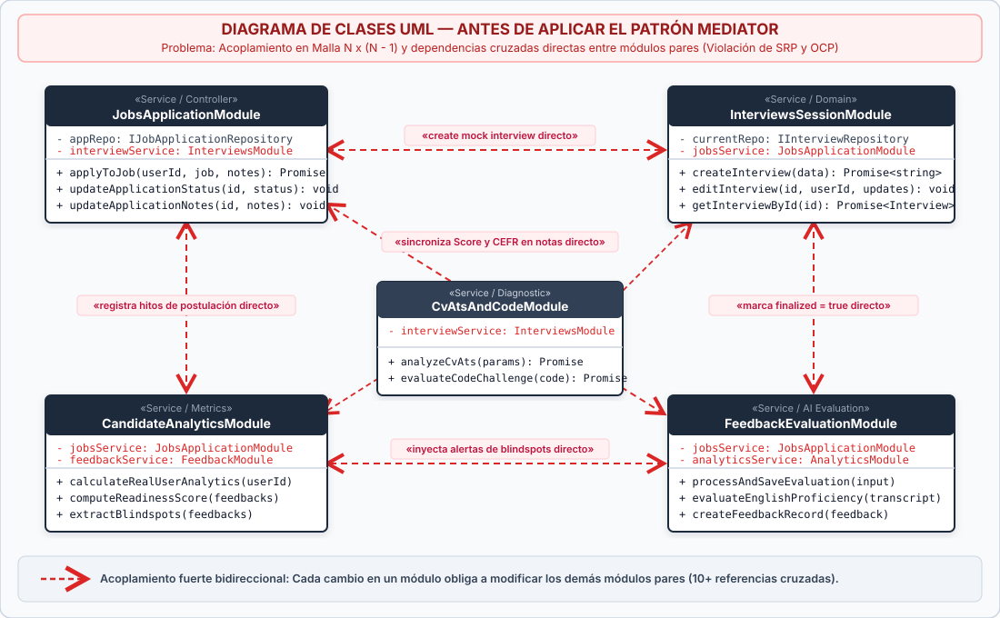
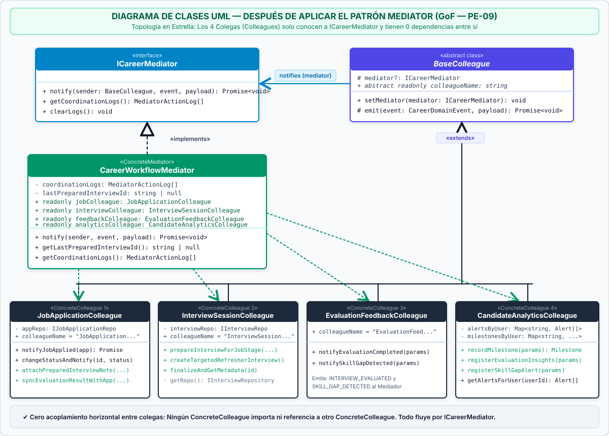
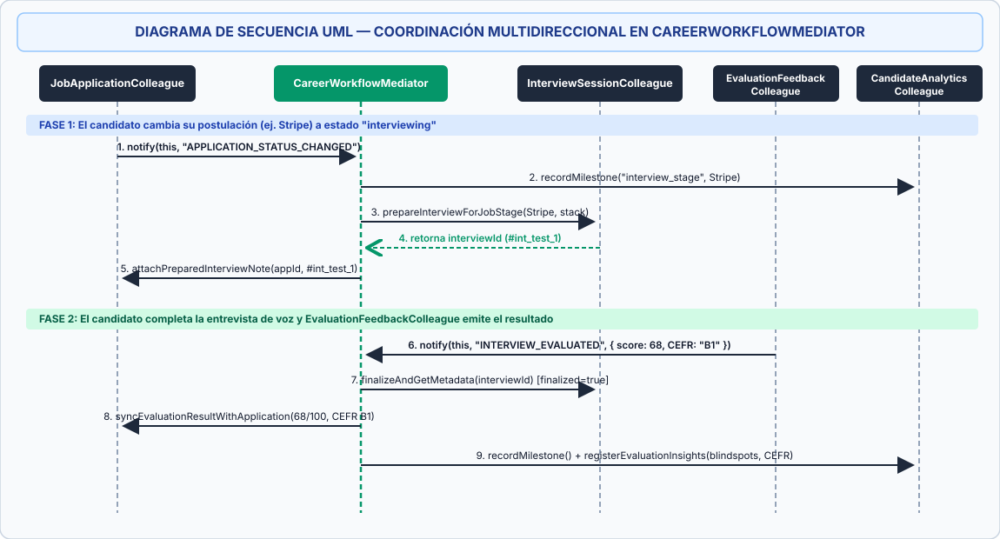

# 🧩 Documentación Técnica: Implementación del Patrón Comportamental Mediator (GoF — PE-09) en DevCareer AI

> **Proyecto:** DevCareer AI — Plataforma de Simulación de Entrevistas de Voz, Búsqueda de Empleo y Analítica con IA  
> **Asignatura:** Patrones de Diseño de Software  
> **Categoría del Patrón:** Comportamental (*Behavioral Pattern* — Gang of Four)  
> **Identificador en el Catálogo:** `PE-09` (`Backend/src/patterns/mediator/`)

---

## 📌 1. Contexto de la Aplicación (`DevCareer AI`)

**DevCareer AI** es una plataforma integral diseñada para preparar a desarrolladores de software en procesos de selección técnica internacional. Su arquitectura *Full-Stack* (Next.js 16 + Node.js/Express + LiveKit WebRTC + Supabase/DynamoDB) se divide en cuatro dominios funcionales principales que interactúan durante el ciclo de preparación del candidato:

1. **Portal de Empleos y Seguimiento de Postulaciones (`/jobs` y `/mis-postulaciones`):** Agrega vacantes internacionales (RemoteOK, LinkedIn, Greenhouse, Lever, Wellfound), calcula el *Match Score* y administra el tablero de postulaciones por estados (`applied`, `interviewing`, `offered`, `rejected`) y notas personales.
2. **Simulador de Entrevistas de Voz en Tiempo Real (`/interview/[id]`):** Sala WebRTC con Silero VAD, Deepgram STT, Groq LLaMA y Cartesia TTS donde el candidato practica entrevistas técnicas y de inglés.
3. **Motor de Evaluación Multidimensional y Diagnóstico IA (`/feedback`, `/cv-analyzer`, `/challenges`):** Califica el desempeño técnico (0–100), evalúa el nivel de inglés según el marco europeo **CEFR (A1–C2)** y detecta brechas de habilidades (*Skill Gaps*) en el CV o en retos de código SOLID.
4. **Panel de Progreso y Analítica en Vivo (`/analytics`):** Calcula el *Índice de Empleabilidad* (*Readiness Score*), el radar pentagonal de competencias, el registro cronológico de hitos y las alertas de puntos ciegos (*blindspots*).

### Estado Previo del Catálogo de Patrones
Antes de esta intervención, el proyecto contaba con **8 patrones GoF** divididos en:
* **5 Creacionales:** `Abstract Factory` (`PE-01`), `Factory Method` (`PE-02`), `Builder` (`PE-03`), `Prototype` (`PE-04`) y `Singleton` (`PE-05`).
* **3 Estructurales:** `Bridge` (`PE-06`), `Facade` (`PE-07`) y `Adapter` (`PE-08`).

Sin embargo, el proyecto **no contaba con un patrón Comportamental (`Behavioral`)** que coordinara las reacciones cruzadas entre estos cuatro módulos cuando ocurrían eventos de negocio.

---

## ⚠️ 2. Problemática Arquitectónica (ANTES de aplicar el Patrón Mediator)

### El Problema: Acoplamiento en Malla $N \times (N-1)$ vs. Módulos Aislados
En el flujo real de un candidato dentro de **DevCareer AI**, una acción en un módulo requiere desencadenar efectos secundarios en los demás módulos pares:

1. **Cuando una postulación cambia a estado `"interviewing"` (`PATCH /jobs/applications/:id/status`):**
   * El módulo de **Entrevistas** debe ensamblar automáticamente un simulacro técnico contextualizado para esa empresa, rol y *techstack*.
   * El módulo de **Postulaciones** debe adjuntar en las notas de seguimiento el ID del simulacro preparado.
   * El módulo de **Analítica** debe registrar el hito de avance en la línea de tiempo del candidato.
2. **Cuando una entrevista finaliza y es evaluada por la IA (`POST /feedback`):**
   * El módulo de **Entrevistas** debe marcar la sesión como `finalized = true`.
   * El módulo de **Postulaciones** debe buscar si la entrevista corresponde a una vacante activa de esa empresa y actualizar sus notas con el puntaje obtenido (`score/100`) y el nivel de inglés (`CEFR`).
   * El módulo de **Analítica** debe registrar el hito de evaluación y generar alertas de puntos ciegos (*blindspots*) si el puntaje fue bajo o si el nivel de inglés fue inferior a `B2`.
3. **Cuando el Analizador de CV ATS o un Reto de Código detecta brechas (`missingSkills`):**
   * El módulo de **Entrevistas** debe generar una entrevista de refuerzo enfocada en las tecnologías faltantes.
   * El módulo de **Analítica** debe levantar una alerta de brecha técnica prioritaria.

**Sin el patrón Mediator**, para lograr esta comunicación bidireccional/multidireccional, cada servicio o controlador tendría que importar e invocar directamente a todos los demás servicios (`JobsService` $\leftrightarrow$ `InterviewsService` $\leftrightarrow$ `FeedbackService` $\leftrightarrow$ `AnalyticsService`), generando una **topología en malla acoplada** que viola los principios **SRP** (*Single Responsibility Principle*) y **OCP** (*Open/Closed Principle*).

### 📊 Diagrama de Clases UML — ANTES del Patrón Mediator



---

## 🛠️ 3. Solución Implementada (DESPUÉS de aplicar el Patrón Mediator)

### ¿Por qué `Mediator` y en qué se diferencia de `Facade` (`PE-07`)?
* **`Facade` (Estructural — ya existente en el proyecto):** Opera de forma **unidireccional** (de arriba hacia abajo). Un controlador HTTP invoca a `InterviewEvaluationFacade` para simplificar llamadas a subsistemas, pero los subsistemas no se notifican eventos entre sí.
* **`Mediator` (Comportamental — implementado como `PE-09`):** Opera de forma **multidireccional entre componentes pares (`Colleagues`)**. Transforma un grafo de dependencias muchos-a-muchos ($N \times (N-1)$) en una **topología en estrella ($N \to 1$)**. Ningún colega importa a otro colega; cada uno conoce únicamente la interfaz `ICareerMediator` y emite eventos mediante `this.emit(event, payload)`.

### Participantes GoF Implementados en `Backend/src/patterns/mediator/`

1. **`ICareerMediator` (`Mediator` Interface):**
   * Archivo: [`Backend/src/patterns/mediator/career-mediator.interface.ts`](file:///c:/Users/JhonM/OneDrive/Documentos/patrones%20de%20dise%C3%B1o%20de%20software/1er%20corte/parcial/DevCareer-AI-PATRONES/Backend/src/patterns/mediator/career-mediator.interface.ts)
   * Declara el contrato `notify(sender: BaseColleague, event: CareerDomainEvent, payload)` y los métodos de auditoría `getCoordinationLogs()` y `clearLogs()`.
2. **`BaseColleague` (`Colleague` Abstract Class):**
   * Archivo: [`Backend/src/patterns/mediator/base.colleague.ts`](file:///c:/Users/JhonM/OneDrive/Documentos/patrones%20de%20dise%C3%B1o%20de%20software/1er%20corte/parcial/DevCareer-AI-PATRONES/Backend/src/patterns/mediator/base.colleague.ts)
   * Almacena la referencia `protected mediator?: ICareerMediator`, expone `setMediator(mediator)` y el método protegido `emit(event, payload)`.
3. **`CareerWorkflowMediator` (`ConcreteMediator`):**
   * Archivo: [`Backend/src/patterns/mediator/career-workflow.mediator.ts`](file:///c:/Users/JhonM/OneDrive/Documentos/patrones%20de%20dise%C3%B1o%20de%20software/1er%20corte/parcial/DevCareer-AI-PATRONES/Backend/src/patterns/mediator/career-workflow.mediator.ts)
   * Recibe los 4 colegas concretos, los suscribe a sí mismo (`colleague.setMediator(this)`) y centraliza toda la lógica de reacción transversal para los eventos `JOB_APPLIED`, `APPLICATION_STATUS_CHANGED`, `INTERVIEW_EVALUATED` y `SKILL_GAP_DETECTED`.
4. **Los 4 Colegas Concretos (`ConcreteColleagues`):**
   * **`JobApplicationColleague`** ([`job-application.colleague.ts`](file:///c:/Users/JhonM/OneDrive/Documentos/patrones%20de%20dise%C3%B1o%20de%20software/1er%20corte/parcial/DevCareer-AI-PATRONES/Backend/src/patterns/mediator/colleagues/job-application.colleague.ts)): Emite `JOB_APPLIED` y `APPLICATION_STATUS_CHANGED`. Expone `attachPreparedInterviewNote()` y `syncEvaluationResultWithApplication()` para que el mediador actualice las notas de seguimiento de la postulación sin que otros módulos toquen el repositorio de empleos.
   * **`InterviewSessionColleague`** ([`interview-session.colleague.ts`](file:///c:/Users/JhonM/OneDrive/Documentos/patrones%20de%20dise%C3%B1o%20de%20software/1er%20corte/parcial/DevCareer-AI-PATRONES/Backend/src/patterns/mediator/colleagues/interview-session.colleague.ts)): Expone `prepareInterviewForJobStage()` (reutilizando internamente `InterviewBuilder` e `InterviewDirector` sin modificarlos), `createTargetedRefresherInterview()` y `finalizeAndGetMetadata()`.
   * **`EvaluationFeedbackColleague`** ([`evaluation-feedback.colleague.ts`](file:///c:/Users/JhonM/OneDrive/Documentos/patrones%20de%20dise%C3%B1o%20de%20software/1er%20corte/parcial/DevCareer-AI-PATRONES/Backend/src/patterns/mediator/colleagues/evaluation-feedback.colleague.ts)): Emite `INTERVIEW_EVALUATED` al finalizar una evaluación de entrevista y `SKILL_GAP_DETECTED` cuando se detectan brechas en CV ATS o Retos de Código.
   * **`CandidateAnalyticsColleague`** ([`candidate-analytics.colleague.ts`](file:///c:/Users/JhonM/OneDrive/Documentos/patrones%20de%20dise%C3%B1o%20de%20software/1er%20corte/parcial/DevCareer-AI-PATRONES/Backend/src/patterns/mediator/colleagues/candidate-analytics.colleague.ts)): Reacciona registrando hitos coordinados (`recordMilestone`) y generando alertas proactivas de puntos ciegos técnicos y lingüísticos CEFR (`registerEvaluationInsights`, `registerSkillGapAlert`).

---

### 📊 Diagrama de Clases UML — DESPUÉS del Patrón Mediator



---

## 🔄 4. Diagrama de Secuencia UML de los Flujos Coordinados



---

## 📂 5. Resumen de Archivos Creados y Modificados

| Archivo | Tipo de Cambio | Descripción Técnica |
| :--- | :--- | :--- |
| [`Backend/src/patterns/mediator/career-mediator.interface.ts`](file:///c:/Users/JhonM/OneDrive/Documentos/patrones%20de%20dise%C3%B1o%20de%20software/1er%20corte/parcial/DevCareer-AI-PATRONES/Backend/src/patterns/mediator/career-mediator.interface.ts) | **Nuevo** | Interfaz `ICareerMediator`, eventos `CareerDomainEvent`, mapa tipado de payloads y estructura `MediatorActionLog`. |
| [`Backend/src/patterns/mediator/base.colleague.ts`](file:///c:/Users/JhonM/OneDrive/Documentos/patrones%20de%20dise%C3%B1o%20de%20software/1er%20corte/parcial/DevCareer-AI-PATRONES/Backend/src/patterns/mediator/base.colleague.ts) | **Nuevo** | Clase abstracta `BaseColleague` con inyección de `ICareerMediator` y emisión desacoplada de eventos. |
| [`Backend/src/patterns/mediator/colleagues/job-application.colleague.ts`](file:///c:/Users/JhonM/OneDrive/Documentos/patrones%20de%20dise%C3%B1o%20de%20software/1er%20corte/parcial/DevCareer-AI-PATRONES/Backend/src/patterns/mediator/colleagues/job-application.colleague.ts) | **Nuevo** | Colega de postulaciones; emite cambios de estado y sincroniza notas de seguimiento con resultados de simulacros. |
| [`Backend/src/patterns/mediator/colleagues/interview-session.colleague.ts`](file:///c:/Users/JhonM/OneDrive/Documentos/patrones%20de%20dise%C3%B1o%20de%20software/1er%20corte/parcial/DevCareer-AI-PATRONES/Backend/src/patterns/mediator/colleagues/interview-session.colleague.ts) | **Nuevo** | Colega de entrevistas; ensambla simulacros automáticos con `Builder`/`Director` y marca sesiones como finalizadas. |
| [`Backend/src/patterns/mediator/colleagues/evaluation-feedback.colleague.ts`](file:///c:/Users/JhonM/OneDrive/Documentos/patrones%20de%20dise%C3%B1o%20de%20software/1er%20corte/parcial/DevCareer-AI-PATRONES/Backend/src/patterns/mediator/colleagues/evaluation-feedback.colleague.ts) | **Nuevo** | Colega de evaluación; notifica calificaciones de entrevistas (`INTERVIEW_EVALUATED`) y brechas (`SKILL_GAP_DETECTED`). |
| [`Backend/src/patterns/mediator/colleagues/candidate-analytics.colleague.ts`](file:///c:/Users/JhonM/OneDrive/Documentos/patrones%20de%20dise%C3%B1o%20de%20software/1er%20corte/parcial/DevCareer-AI-PATRONES/Backend/src/patterns/mediator/colleagues/candidate-analytics.colleague.ts) | **Nuevo** | Colega de analítica; registra hitos transversales y alertas proactivas de puntos ciegos técnicos y CEFR. |
| [`Backend/src/patterns/mediator/career-workflow.mediator.ts`](file:///c:/Users/JhonM/OneDrive/Documentos/patrones%20de%20dise%C3%B1o%20de%20software/1er%20corte/parcial/DevCareer-AI-PATRONES/Backend/src/patterns/mediator/career-workflow.mediator.ts) | **Nuevo** | Mediador concreto `CareerWorkflowMediator` y proveedor singleton/default `getDefaultCareerMediator()`. |
| [`Backend/src/patterns/mediator/index.ts`](file:///c:/Users/JhonM/OneDrive/Documentos/patrones%20de%20dise%C3%B1o%20de%20software/1er%20corte/parcial/DevCareer-AI-PATRONES/Backend/src/patterns/mediator/index.ts) | **Nuevo** | Barrel file de exportación del módulo `mediator`. |
| [`Backend/src/patterns/index.ts`](file:///c:/Users/JhonM/OneDrive/Documentos/patrones%20de%20dise%C3%B1o%20de%20software/1er%20corte/parcial/DevCareer-AI-PATRONES/Backend/src/patterns/index.ts) | **Modificado** | Registra la categoría `3. PATRONES COMPORTAMENTALES: Mediator` en el catálogo central. |
| [`Backend/src/routes/jobs.routes.ts`](file:///c:/Users/JhonM/OneDrive/Documentos/patrones%20de%20dise%C3%B1o%20de%20software/1er%20corte/parcial/DevCareer-AI-PATRONES/Backend/src/routes/jobs.routes.ts) | **Modificado** | Integra `jobColleague` en `POST /jobs/apply` (`JOB_APPLIED`) y `PATCH /jobs/applications/:id/status` (`APPLICATION_STATUS_CHANGED`). |
| [`Backend/src/routes/feedback.routes.ts`](file:///c:/Users/JhonM/OneDrive/Documentos/patrones%20de%20dise%C3%B1o%20de%20software/1er%20corte/parcial/DevCareer-AI-PATRONES/Backend/src/routes/feedback.routes.ts) | **Modificado** | Notifica `INTERVIEW_EVALUATED` tras guardar feedback (`POST /feedback`) y expone `GET /feedback/mediator/logs`. |
| [`Backend/src/routes/cv.routes.ts`](file:///c:/Users/JhonM/OneDrive/Documentos/patrones%20de%20dise%C3%B1o%20de%20software/1er%20corte/parcial/DevCareer-AI-PATRONES/Backend/src/routes/cv.routes.ts) | **Modificado** | Invoca `notifySkillGapDetected` (`source: "cv-ats"`) en `POST /api/cv/analyze` cuando `score < 75` o hay `missingKeywords`. |
| [`Backend/src/routes/code.routes.ts`](file:///c:/Users/JhonM/OneDrive/Documentos/patrones%20de%20dise%C3%B1o%20de%20software/1er%20corte/parcial/DevCareer-AI-PATRONES/Backend/src/routes/code.routes.ts) | **Modificado** | Invoca `notifySkillGapDetected` (`source: "code-challenge"`) en `POST /code/feedback` cuando `score < 75`, fallan tests o falta patrón SOLID. |
| [`Backend/src/services/analytics.service.ts`](file:///c:/Users/JhonM/OneDrive/Documentos/patrones%20de%20dise%C3%B1o%20de%20software/1er%20corte/parcial/DevCareer-AI-PATRONES/Backend/src/services/analytics.service.ts) | **Modificado** | Incorpora alertas de brechas e hitos transversales de `CandidateAnalyticsColleague` en `GET /feedback/user/analytics-summary`. |
| [`scripts/test-mediator.js`](file:///c:/Users/JhonM/OneDrive/Documentos/patrones%20de%20dise%C3%B1o%20de%20software/1er%20corte/parcial/DevCareer-AI-PATRONES/scripts/test-mediator.js) | **Nuevo** | Suite de pruebas unitarias/aisladas que verifica los 4 flujos del Mediador en memoria. |
| [`scripts/test-mediator-integration.js`](file:///c:/Users/JhonM/OneDrive/Documentos/patrones%20de%20dise%C3%B1o%20de%20software/1er%20corte/parcial/DevCareer-AI-PATRONES/scripts/test-mediator-integration.js) | **Nuevo** | Suite de pruebas de integración E2E HTTP sobre Express validando todas las rutas conectadas al Mediador. |

---

## 🧪 6. Verificación y Ejecución de Pruebas

Para compilar y ejecutar tanto las pruebas unitarias como las pruebas de integración E2E HTTP del patrón **Mediator**:

```bash
# 1. Compilar el Backend en TypeScript
npm --prefix Backend run build

# 2. Ejecutar la suite unitaria aislada del Patrón Mediator
node scripts/test-mediator.js

# 3. Ejecutar la suite de integración E2E HTTP sobre el servidor Express
node scripts/test-mediator-integration.js
```

**Salida verificada (`test-mediator.js`):**
```text
===================================================
PRUEBA DE PATRÓN COMPORTAMENTAL: MEDIATOR (GoF)
===================================================

1. Flujo JOB_APPLIED: JobApplicationColleague -> Mediator -> CandidateAnalyticsColleague...
   ✅ CandidateAnalyticsColleague registró el hito de postulación
   ✅ El hito de analítica incluye la empresa de la postulación

2. Flujo APPLICATION_STATUS_CHANGED ('interviewing'): prepara entrevista y anota en postulación...
   ✅ InterviewSessionColleague creó simulacro (int_test_1)
   ✅ El simulacro creado por InterviewSessionColleague está contextualizado para Stripe
   ✅ JobApplicationColleague recibió en sus notas el vínculo al simulacro preparado

3. Flujo INTERVIEW_EVALUATED: Feedback -> Finaliza Entrevista + Actualiza Postulación + Genera Alertas...
   ✅ InterviewSessionColleague marcó la entrevista como finalizada
   ✅ JobApplicationColleague sincronizó el puntaje y nivel CEFR en las notas de la postulación
   ✅ CandidateAnalyticsColleague generó alertas de brecha técnica y CEFR B1

4. Flujo SKILL_GAP_DETECTED: Brecha en CV ATS dispara simulacro de refuerzo + alerta...
   ✅ InterviewSessionColleague creó entrevista de refuerzo con las skills faltantes (Kubernetes, Terraform)
   ✅ El Mediador registró las 4 transacciones coordinadas (4 logs)

🎉 Todas las pruebas del patrón Mediator pasaron correctamente.
```

**Salida verificada (`test-mediator-integration.js`):**
```text
=========================================================================
PRUEBA DE INTEGRACIÓN E2E DE LA APP: PATRÓN MEDIATOR COMPLETO (GoF PE-09)
=========================================================================

✅ Backend DevCareer corriendo en http://localhost:3098
   Entorno: test
1. Verificando Health Check del Backend...
   ✅ Backend en línea y respondiendo en puerto 3098

2. Probando flujo JOB_APPLIED vía POST /jobs/apply...
   ✅ POST /jobs/apply respondió 201 Created

3. Probando flujo APPLICATION_STATUS_CHANGED ('interviewing') vía PATCH /jobs/applications/:id/status...
   ✅ PATCH status respondió 200 OK
   ✅ Simulacro creado automáticamente: mock_interview_id
   ✅ Notas de postulación actualizadas con el ID del simulacro

4. Probando flujo SKILL_GAP_DETECTED (CV ATS) vía POST /api/cv/analyze...
   ✅ POST /api/cv/analyze respondió 200 OK
   ✅ El Mediador creó entrevista de refuerzo ATS automáticamente: mock_interview_id

5. Probando flujo SKILL_GAP_DETECTED (Reto de Código) vía POST /code/feedback...
   ✅ POST /code/feedback respondió 200 OK
   ✅ El Mediador creó entrevista de refuerzo SOLID automáticamente: mock_interview_id

6. Probando flujo INTERVIEW_EVALUATED (sincronización de entrevista + postulación + analítica)...
   ✅ Postulación sincronizada con calificación (72/100) y nivel CEFR (B2)

7. Verificando auditoría del Mediador y propagación a Analítica...
   ✅ Se registraron las 5 transacciones en Mediator (5 logs)
   ✅ Se generaron 3 alertas (Evaluación + CV ATS + Reto Código)
   ✅ GET /feedback/user/analytics-summary refleja en tiempo real las alertas generadas por el Mediador

=========================================================================
🎉 ¡TODAS LAS PRUEBAS E2E DEL PATRÓN MEDIATOR PASARON AL 100%!
=========================================================================
```

