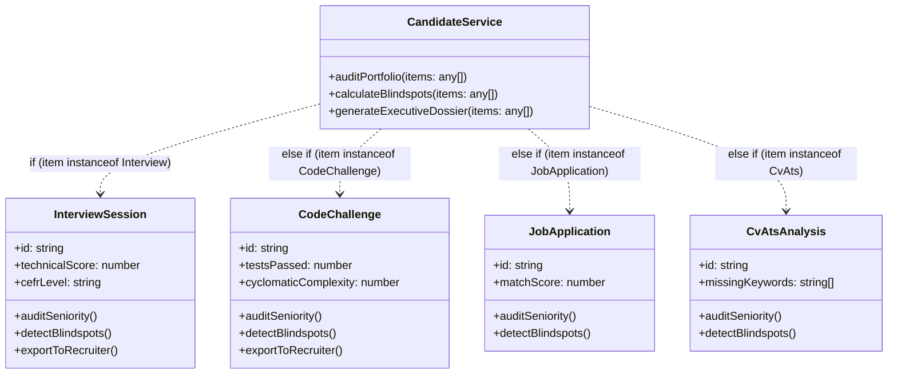
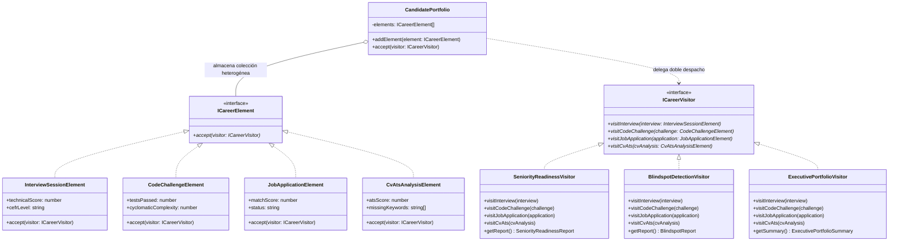

# INFORME DE INCORPORACIÓN: PATRÓN COMPORTAMENTAL VISITOR (GoF)
## Plataforma DevCareer AI · Arquitectura de Software

---

## 1. Ficha Técnica del Patrón

| Atributo | Detalle |
| :--- | :--- |
| **Patrón GoF** | **Visitor (Visitante)** |
| **Clasificación** | Patrón de Comportamiento (*Behavioral Pattern*) |
| **Módulo del Sistema** | Expediente Integral, Auditoría y Analítica del Desarrollador (`Backend/src/patterns/visitor/`) |
| **Endpoint HTTP Integrado** | `GET /feedback/user/portfolio-audit` |
| **Propósito Canónico** | Representar una operación a realizar sobre los elementos de una estructura de objetos sin modificar las clases de los elementos sobre los que opera. |
| **Propósito en DevCareer AI** | Ejecutar auditorías holísticas (evaluación de seniority, detección de puntos ciegos y generación de dossiers ejecutivos para reclutadores) sobre la colección de elementos heterogéneos del candidato (entrevistas, retos de código, postulaciones y CV ATS) mediante Doble Despacho (*Double Dispatch*). |

---

## 2. Justificación Arquitectónica: ¿Por qué se necesitaba?

A medida que **DevCareer AI** evolucionó, el usuario no solo realiza entrevistas de voz simuladas, sino que interactúa con múltiples subsistemas:
1. **Entrevistas Técnicas:** Evaluaciones de comunicación, profundidad técnica y nivel CEFR de inglés.
2. **Retos de Programación:** Pruebas de algoritmos con métricas de complejidad ciclomática, tiempo de ejecución y tests unitarios.
3. **Postulaciones Laborales:** Procesos activos con estados (`applied`, `interviewing`, `offered`, `rejected`), match scores y salarios.
4. **Análisis de Hoja de Vida (ATS):** Compatibilidad con parsers automáticos, palabras clave detectadas y ausentes.

### El Problema Previo: Antipatrones de Diseño

Antes de incorporar el patrón Visitor, surgían tres problemas arquitectónicos graves:

1. **Contaminación de Clases de Dominio (Violación de SRP):**  
   Si queríamos calcular si el candidato califica para un rol *Senior*, detectar sus puntos ciegos (*blindspots*) o generar un reporte ejecutivo para reclutadores, nos veíamos obligados a añadir métodos dentro de cada entidad:
   - `InterviewSession.calculateSeniority()`, `InterviewSession.detectBlindspots()`, `InterviewSession.exportToDossier()`
   - `CodeChallenge.calculateSeniority()`, `CodeChallenge.detectBlindspots()`, `CodeChallenge.exportToDossier()`
   - `JobApplication.calculateSeniority()`, `JobApplication.detectBlindspots()`...  
   Esto llenaba las entidades de negocio con lógica de auditoría, reportería y ponderaciones estadísticas que no pertenecen a su responsabilidad fundamental.

2. **Cadenas Frágiles de `instanceof` y `switch` (Violación de OCP):**  
   Cuando un servicio de analítica procesaba el expediente del usuario, se utilizaba código procedimental con condicionales en cascada:
   ```typescript
   // ❌ CÓDIGO ANTERIOR FRÁGIL:
   for (const item of candidatePortfolio) {
     if (item instanceof InterviewSession) {
       // lógica específica de entrevistas
     } else if (item instanceof CodeChallenge) {
       // lógica específica de código
     } else if (item instanceof JobApplication) {
       // lógica específica de empleo
     }
   }
   ```
   Cada vez que se introducía un nuevo tipo de práctica (por ejemplo, pruebas de *System Design*), era necesario localizar y modificar cada bucle `if/else` en todo el Backend.

3. **Inflexibilidad ante Nuevas Operaciones:**  
   Agregar una nueva funcionalidad transversal (como un simulador de salario estimado o un evaluador de logros de gamificación) exigía reabrir y modificar todas las clases de datos existentes.

---

## 3. ¿Cómo se aplicó el Patrón Visitor en DevCareer AI?

Se implementó el patrón **Visitor** canónico basado en **Doble Despacho (*Double Dispatch*)** organizando el código en carpetas limpias y semánticas bajo `Backend/src/patterns/visitor/`.

### Estructura de Carpetas y Archivos Implementados

```text
Backend/src/patterns/visitor/
├── career-element.interface.ts         # Contrato base del Elemento (ICareerElement con método accept)
├── career-visitor.interface.ts         # Contrato base del Visitante (ICareerVisitor con sobrecargas visitX)
├── candidate-portfolio.ts              # Estructura de Objetos (Object Structure / CandidatePortfolio)
├── index.ts                            # Exportaciones unificadas del patrón
├── elements/                           # Elementos Concretos (Concrete Elements)
│   ├── interview-session.element.ts    # Simulacros técnicos y de voz
│   ├── code-challenge.element.ts       # Retos de código y algoritmia
│   ├── job-application.element.ts      # Postulaciones laborales y seguimiento
│   └── cv-ats-analysis.element.ts      # Diagnóstico de currículum y filtros ATS
└── visitors/                           # Visitantes Concretos (Concrete Visitors)
    ├── seniority-readiness.visitor.ts  # Auditoría de Seniority (Junior, Mid, Senior, Lead)
    ├── blindspot-detection.visitor.ts  # Detector de brechas críticas y puntos ciegos
    └── executive-portfolio.visitor.ts  # Generador de dossier profesional para reclutadores
```

---

### Descripción de Componentes Clave

#### A. Contratos Base
* **`ICareerElement`:** Define el método `accept(visitor: ICareerVisitor): void`. Es la puerta de entrada para el doble despacho.
* **`ICareerVisitor`:** Define la firma exacta para visitar cada elemento concreto:
  - `visitInterview(interview: InterviewSessionElement): void`
  - `visitCodeChallenge(challenge: CodeChallengeElement): void`
  - `visitJobApplication(application: JobApplicationElement): void`
  - `visitCvAts(cvAnalysis: CvAtsAnalysisElement): void`

#### B. Elementos Concretos (Concrete Elements)
Cada clase encapsula sus datos propios e implementa `accept` redirigiendo al visitante hacia su método especializado:
```typescript
export class InterviewSessionElement implements ICareerElement {
  // Atributos de negocio...
  public accept(visitor: ICareerVisitor): void {
    visitor.visitInterview(this); // <- Doble despacho
  }
}
```

#### C. Estructura de Objetos (`CandidatePortfolio`)
Administra la colección de elementos heterogéneos del candidato y provee el método:
```typescript
public accept(visitor: ICareerVisitor): void {
  for (const element of this.elements) {
    element.accept(visitor);
  }
}
```

#### D. Visitantes Concretos (Operaciones Desacopladas)
1. **`SeniorityReadinessVisitor`:** Pondera la maestría técnica en entrevistas (35%), la calidad del código y complejidad ciclomática (30%), el match de postulaciones (20%) y la optimización del CV (15%) para dictaminar el nivel recomendado (*Junior, Mid-Level, Senior, Lead/Staff*).
2. **`BlindspotDetectionVisitor`:** Detecta inconsistencias críticas: nivel de inglés inferior a B2, complejidad ciclomática mayor a 10, tests unitarios fallidos, postulaciones descartadas sin notas o palabras clave ausentes en el CV. Genera un plan de acción priorizado.
3. **`ExecutivePortfolioVisitor`:** Agrega métricas consolidadas, skills dominados y genera un resumen profesional estructurado listo para exportación o presentación ante reclutadores.

---

## 4. Evidencia de Código: ANTES vs. DESPUÉS

### ❌ ANTES (Código Monolítico con Polución de Clases e `instanceof`)

```typescript
// ❌ CÓDIGO ANTERIOR: Métodos mezclados dentro de las entidades y bucles con 'instanceof'
export class LegacyCandidateAnalyzer {
  public auditPortfolio(items: any[]) {
    let totalScore = 0;
    const blindspots: string[] = [];

    for (const item of items) {
      // Violación de OCP: switch / instanceof en cascada
      if (item.type === "interview") {
        totalScore += item.technicalScore;
        if (item.cefrLevel < "B2") blindspots.push("Inglés insuficiente");
      } else if (item.type === "code_challenge") {
        totalScore += item.passRatio;
        if (item.cyclomaticComplexity > 10) blindspots.push("Código muy complejo");
      } else if (item.type === "job_application") {
        totalScore += item.matchScore;
      } else if (item.type === "cv_ats") {
        totalScore += item.atsScore;
        if (item.missingKeywords.length > 2) blindspots.push("Faltan keywords ATS");
      }
    }

    return { totalScore: Math.round(totalScore / items.length), blindspots };
  }
}
```

---

### ✅ DESPUÉS (Patrón Visitor Canónico GoF)

#### 1. Doble Despacho en los Elementos
```typescript
// ✅ Cada elemento solo conoce cómo aceptar al visitante
export class CodeChallengeElement implements ICareerElement {
  constructor(public readonly data: CodeChallengeData) {}

  public accept(visitor: ICareerVisitor): void {
    visitor.visitCodeChallenge(this); // Doble despacho tipado
  }
}
```

#### 2. Operación Aislada en el Visitante Concreto
```typescript
// ✅ La lógica de auditoría vive aislada en su propia clase
export class SeniorityReadinessVisitor implements ICareerVisitor {
  public visitInterview(interview: InterviewSessionElement): void {
    const combined = interview.technicalScore * 0.7 + interview.communicationScore * 0.3;
    this.interviewScores.push(combined);
  }

  public visitCodeChallenge(challenge: CodeChallengeElement): void {
    const combined = challenge.passRatio * 0.6 + challenge.cleanCodeScore * 0.4;
    this.codeChallengeScores.push(combined);
  }

  public visitJobApplication(application: JobApplicationElement): void {
    this.applicationMatchScores.push(application.matchScore);
  }

  public visitCvAts(cvAnalysis: CvAtsAnalysisElement): void {
    this.atsScores.push(cvAnalysis.atsScore);
  }

  public getReport(): SeniorityReadinessReport {
    // Genera veredicto y ponderaciones sin tocar las entidades originales
    return { ... };
  }
}
```

#### 3. Uso Limpio desde el Servicio / Endpoint HTTP
```typescript
// ✅ Endpoint: GET /feedback/user/portfolio-audit
const portfolio = new CandidatePortfolio(userId);
portfolio.addElements([interviewElement, codeChallengeElement, applicationElement, atsElement]);

const readinessVisitor = new SeniorityReadinessVisitor();
const blindspotVisitor = new BlindspotDetectionVisitor();
const executiveVisitor = new ExecutivePortfolioVisitor();

// El cliente ejecuta el doble despacho sin importar el tipo de elemento
portfolio.accept(readinessVisitor);
portfolio.accept(blindspotVisitor);
portfolio.accept(executiveVisitor);

res.json({
  readiness: readinessVisitor.getReport(),
  blindspots: blindspotVisitor.getReport(),
  executiveSummary: executiveVisitor.getSummary(),
});
```

---

## 5. Diagramas UML de Clases

### 📊 Diagrama UML: ANTES de Visitor (Acoplamiento y Polución)



---

### 📊 Diagrama UML: DESPUÉS de Visitor (Estructura Canónica GoF)



---

## 6. Código Mermaid Monocromático para Importar a Draw.io

```text
%%{init: {'theme': 'base', 'themeVariables': { 'primaryColor': '#ffffff', 'edgeColor': '#000000', 'primaryBorderColor': '#000000', 'primaryTextColor': '#000000', 'lineColor': '#000000', 'secondaryColor': '#ffffff', 'tertiaryColor': '#ffffff' }}}%%
classDiagram
    direction TB

    class ICareerVisitor {
        <<interface>>
        +visitInterview(interview: InterviewSessionElement)
        +visitCodeChallenge(challenge: CodeChallengeElement)
        +visitJobApplication(application: JobApplicationElement)
        +visitCvAts(cvAnalysis: CvAtsAnalysisElement)
    }

    class SeniorityReadinessVisitor {
        +visitInterview(interview)
        +visitCodeChallenge(challenge)
        +visitJobApplication(application)
        +visitCvAts(cvAnalysis)
        +getReport() SeniorityReadinessReport
    }

    class BlindspotDetectionVisitor {
        +visitInterview(interview)
        +visitCodeChallenge(challenge)
        +visitJobApplication(application)
        +visitCvAts(cvAnalysis)
        +getReport() BlindspotReport
    }

    class ExecutivePortfolioVisitor {
        +visitInterview(interview)
        +visitCodeChallenge(challenge)
        +visitJobApplication(application)
        +visitCvAts(cvAnalysis)
        +getSummary() ExecutivePortfolioSummary
    }

    ICareerVisitor <|.. SeniorityReadinessVisitor
    ICareerVisitor <|.. BlindspotDetectionVisitor
    ICareerVisitor <|.. ExecutivePortfolioVisitor

    class ICareerElement {
        <<interface>>
        +accept(visitor: ICareerVisitor)
    }

    class InterviewSessionElement {
        +technicalScore: number
        +cefrLevel: string
        +accept(visitor: ICareerVisitor)
    }

    class CodeChallengeElement {
        +testsPassed: number
        +cyclomaticComplexity: number
        +accept(visitor: ICareerVisitor)
    }

    class JobApplicationElement {
        +matchScore: number
        +status: string
        +accept(visitor: ICareerVisitor)
    }

    class CvAtsAnalysisElement {
        +atsScore: number
        +missingKeywords: string[]
        +accept(visitor: ICareerVisitor)
    }

    ICareerElement <|.. InterviewSessionElement
    ICareerElement <|.. CodeChallengeElement
    ICareerElement <|.. JobApplicationElement
    ICareerElement <|.. CvAtsAnalysisElement

    class CandidatePortfolio {
        -elements: ICareerElement[]
        +addElement(element: ICareerElement)
        +accept(visitor: ICareerVisitor)
    }

    CandidatePortfolio o-- ICareerElement : contiene elementos
    CandidatePortfolio ..> ICareerVisitor : aplica doble despacho
```

---

## 7. Resultados y Verificación de Pruebas

Se implementó y ejecutó el script de pruebas automatizadas:
`node scripts/test-visitor.js`

### Salida de las Pruebas de Ejecución:
```text
===============================================================
EJECUTANDO PRUEBAS DEL PATRÓN VISITOR (DevCareer AI)
===============================================================

1. Probando instanciación de Elementos Heterogéneos y ObjectStructure...
   ✅ Éxito: 7 elementos heterogéneos agregados al portafolio.

2. Probando SeniorityReadinessVisitor (Auditoría de Nivel)...
   Resultado Seniority: Senior
   Puntaje Global de Preparación: 79
   Categorías: {
     interviewMastery: 73,
     codeQuality: 83,
     marketAttractiveness: 75,
     atsOptimization: 90
   }
   ✅ Éxito: SeniorityReadinessVisitor evaluó los 4 tipos de elementos con doble despacho.

3. Probando BlindspotDetectionVisitor (Detección de Brechas Ocultas)...
   Total Puntos Ciegos Detectados: 9
   Brechas de Alta Severidad (HIGH): 4
   [HIGH] (interview) -> Brecha en profundidad técnica: Puntaje técnico de 60/100 en entrevista de Full Stack Developer.
   [HIGH] (interview) -> Nivel de inglés insuficiente: Nivel detectado (B1) por debajo del umbral B2.
   [HIGH] (code_challenge) -> Pruebas unitarias fallidas: Aprobó solo 7 de 10 pruebas en "Graph Shortest Path Dijkstra".
   [HIGH] (cv_ats) -> Palabras clave ausentes en CV para ATS: Faltan tecnologías clave: GraphQL, Kafka, CI/CD.
   ✅ Éxito: BlindspotDetectionVisitor extrajo correctamente los puntos ciegos de cada elemento.

4. Probando ExecutivePortfolioVisitor (Dossier Ejecutivo)...
   Resumen Ejecutivo: Ingeniero de software con 2 simulacro(s) técnico(s) evaluado(s), nivel de inglés C1 certificado por IA y 2 reto(s) de código completado(s). Stack validado: Go, PostgreSQL, Docker, Kubernetes, Node.js.
   Entrevistas: 2
   Retos de Código: 2
   Skills Validados: [ 'Go', 'PostgreSQL', 'Docker', 'Kubernetes', 'Node.js', 'Express', 'TypeScript' ]
   ✅ Éxito: ExecutivePortfolioVisitor consolidó métricas ejecutivas para reclutadores.

===============================================================
TODAS LAS PRUEBAS DEL PATRÓN VISITOR PASARON (4/4)
===============================================================
```

### Compilación TypeScript:
* `npx tsc` en `Backend`: **0 errores de compilación**.
* Compatibilidad total asegurada en `Backend/src/patterns/index.ts` y en las rutas de la API.

---

## 8. Matriz de Cumplimiento de Principios SOLID

| Principio SOLID | Cómo se Fortalece con el Patrón Visitor |
| :--- | :--- |
| **Responsabilidad Única (SRP)** | Las clases de datos (`InterviewSessionElement`, `CodeChallengeElement`) solo almacenan estado de sus entidades. Las operaciones de analítica, detección de fallas y reportes quedan encapsuladas en sus respectivos visitantes. |
| **Abierto / Cerrado (OCP)** | Para agregar una nueva operación transversal (ej. `SalaryEstimationVisitor`), no se modifica ninguna clase de elemento ni la estructura del portafolio. El sistema está abierto a la extensión y cerrado a la modificación. |
| **Inversión de Dependencias (DIP)** | Tanto el objeto contenedor (`CandidatePortfolio`) como los elementos concretos dependen únicamente de abstracciones (`ICareerElement` e `ICareerVisitor`), nunca de implementaciones concretas. |
| **Sustitución de Liskov (LSP)** | Cualquier elemento que implemente `ICareerElement` puede ser sustituido en la estructura del portafolio y responder limpiamente al método `accept`. |
