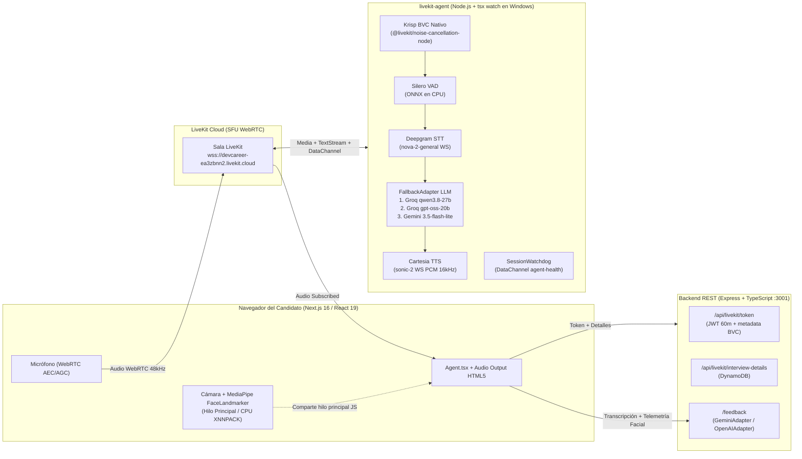

# Informe Técnico: Estado Actual, Problemas de Congelamiento y Stack Tecnológico del Módulo de Entrevistas

**Proyecto:** DevCareer AI  
**Fecha:** 24 de noviembre de 2026  
**Alcance:** Módulo de Entrevistas por Voz en Tiempo Real, Cancelación de Ruido, Reconocimiento Facial (Edge AI) y Evaluación Post-Entrevista.

---

## 1. Resumen Ejecutivo

El módulo de entrevistas de DevCareer AI opera actualmente bajo una **arquitectura en cascada de 6 eslabones en tiempo real** (*Navegador WebRTC → LiveKit Cloud → Krisp BVC → Silero VAD → Deepgram STT → Groq/Gemini LLM → Cartesia TTS → WebRTC de retorno*), corriendo en paralelo con inferencia de **visión por computadora (MediaPipe) en el hilo principal del navegador**.

Aunque las pruebas sintéticas de laboratorio (sin eco de altavoces y con audio pre-grabado) completan 6 turnos continuos, **en sesiones reales de usuario la reproducción de voz vuelve a frenarse**. Esto se debe a una combinación de:
1. **Fragilidad estructural de encadenar 4 APIs externas con cuotas gratuitas/limitadas** (Groq 8,000 TPM, Gemini con errores 503 frecuentes, Cartesia silenciando errores 4xx sin alerta).
2. **Sensibilidad del pipeline de voz real (eco de altavoces, BVC entrenado para auriculares y gestión de interrupciones)**.
3. **Contención de CPU en el navegador** (MediaPipe WASM cayendo a CPU XNNPACK en el mismo hilo que React y WebRTC).
4. **Limitaciones de madurez del SDK `@livekit/agents` en Node.js sobre Windows** (procesos hijos IPC y recargas de `tsx watch`).

Este informe detalla el inventario exacto de APIs y tecnologías vigentes, los problemas técnicos activos y una guía comparativa de alternativas modernas para rediseñar o estabilizar la experiencia del usuario.

---

## 2. Arquitectura Actual del Módulo de Entrevistas

---

## 3. Inventario Completo de APIs, Modelos y Tecnologías en Uso

### 3.1. Pipeline de Voz en Tiempo Real (`livekit-agent/`)

| Capa | Tecnología / Proveedor | Versión / Modelo Exacto | Protocolo | Archivo Principal | Limitación / Riesgo Actual |
| :--- | :--- | :--- | :--- | :--- | :--- |
| **Transporte WebRTC (SFU)** | **LiveKit Cloud** (`livekit-client`, `livekit-server-sdk`) | Cliente `^2.19.1`, Server SDK `^2.15.4` | WebRTC / WSS | `Backend/src/routes/livekit.routes.ts` `frontend/components/Agent.tsx` | Depende de la estabilidad de red del usuario y políticas de autoplay/AudioContext del navegador. |
| **Orquestador de Agente** | **LiveKit Agents for Node.js** (`@livekit/agents`) | `1.4.5` (ejecutado con `tsx watch ^4.15.6` en Windows) | IPC + WebRTC | `livekit-agent/agent.ts` | El SDK de Node.js es menos maduro que el de Python; en Windows los procesos hijos (`job_proc_lazy_main.js`) tienen mayor latencia de arranque e IPC. |
| **Aislamiento de Voz (BVC)** | **Krisp BVC** vía `@livekit/noise-cancellation-node` | `^0.3.1` (binario nativo `liblivekit_nc_plugin.dll`, modelo `hs.c6.f.m.75df8f.kef`) | FFI Rust/C++ en servidor | `livekit-agent/factories/voice-pipeline.factory.ts` | El modelo `hs.*` está optimizado para **auriculares (headset)**; con micrófono abierto de laptop puede atenuar partes de la voz del candidato o generar artefactos con eco. |
| **Detección de Voz (VAD)** | **Silero VAD** (`@livekit/agents-plugin-silero`) | `1.4.5` (ONNX Runtime CPU) | Local CPU | `livekit-agent/agent.ts` | Sensible a ruido de ambiente y eco de altavoces cuando el usuario no usa audífonos. |
| **Speech-to-Text (STT)** | **Deepgram** (`@livekit/agents-plugin-deepgram`) | Modelo `nova-2-general` (`es` / `en`, `16kHz`, `endpointing: 350ms`) | WebSocket (`wss://api.deepgram.com/v1/listen`) | `livekit-agent/factories/voice-pipeline.factory.ts` | `nova-3` dio HTTP 400 en la cuenta actual. En español técnico mezclado con anglicismos (*TypeScript, CI, EXPLAIN ANALYZE*), a veces fragmenta o malinterpreta términos. La API key no tiene scope `billing:read` para monitorear saldo. |
| **LLM Conversacional (Primario)** | **Groq API** (vía `@livekit/agents-plugin-openai`) | `qwen/qwen3.8-27b` (`maxCompletionTokens: 220`) | HTTPS SSE (`api.groq.com/openai/v1`) | `livekit-agent/factories/voice-pipeline.factory.ts` | **Límite muy estricto de `8,000 TPM`** (tokens por minuto) medido en cabeceras `x-ratelimit-limit-tokens`. No tiene disponibles `llama-3.3-70b` ni `llama-3.1-8b` en esta cuenta. |
| **LLM Conversacional (Fallback 1)** | **Groq API** | `openai/gpt-oss-20b` (`maxCompletionTokens: 600`) | HTTPS SSE | `livekit-agent/factories/voice-pipeline.factory.ts` | También limitado a **`8,000 TPM`** y genera tokens de razonamiento interno (`reasoning_len ~140-250`), lo cual consume cuota más rápido. |
| **LLM Conversacional (Fallback 2)** | **Google Gemini API** (endpoint compatible OpenAI) | `gemini-3.5-flash-lite` (`maxCompletionTokens: 220`) | HTTPS SSE (`generativelanguage.googleapis.com/v1beta/openai/`) | `livekit-agent/factories/voice-pipeline.factory.ts` | Reemplazó a `gemini-3.8-flash` porque los modelos Flash principales devuelven **`HTTP 503` (high demand)** frecuentemente en esta cuenta; `gemini-2.5-flash` devuelve `404`. |
| **Text-to-Speech (TTS)** | **Cartesia** (`@livekit/agents-plugin-cartesia`) | Modelo `sonic-2` (`pcm_s16le`, `16000 Hz`, `chunkTimeout: 15000ms`) | WebSocket (`wss://api.cartesia.ai/tts/websocket`) | `livekit-agent/factories/voice-pipeline.factory.ts` `livekit-agent/strategies/voice-agent.strategy.ts` | **Punto ciego crítico:** el plugin silencia errores HTTP `4xx` (ej. `402` créditos agotados o `429` límite de concurrencia) logueándolos a nivel `debug` y produciendo **0 frames de audio** sin lanzar excepción visible. |

### 3.2. Reconocimiento Facial (Edge AI en Navegador — `frontend/lib/facial/`)

| Componente | Tecnología / Librería | Versión / Detalle | Archivo Principal | Limitación / Riesgo Actual |
| :--- | :--- | :--- | :--- | :--- |
| **Detección de Landmarks y Expresiones** | **Google MediaPipe Tasks Vision** (`@mediapipe/tasks-vision`) | `^1.2.3`, modelo `face_landmarker.task` (float16, 478 puntos + 52 blendshapes FACS + matriz 4x4 Euler) | `frontend/lib/facial/mediapipe-face.provider.ts` | **Corre en el hilo principal del navegador**. Cuando falla GPU/WebGL, cae a **CPU XNNPACK** (confirmado en logs de consola), consumiendo CPU en el mismo hilo que procesa UI y eventos de audio WebRTC. |
| **Suavizado y Métricas** | Filtro **One-Euro** + Calibración por Mediana + Estrategias GoF | `Tension`, `EyeContact`, `GestureVolatility`, `BlinkRate`, `PostureWarmth` | `frontend/lib/facial/facial-behavior.aggregator.ts` `frontend/lib/facial/signal-filters.ts` | Acumula todas las muestras (`this.samples`) en memoria durante toda la sesión y la precisión sigue dependiendo fuertemente de iluminación, ángulo de cámara y gafas. |

### 3.3. Backend, Persistencia y Evaluación Post-Entrevista (`Backend/` y `frontend/`)

| Capa | Tecnología | Versión / Detalle | Archivo Principal |
| :--- | :--- | :--- | :--- |
| **Frontend Web** | **Next.js (Webpack dev)** + **React** + **Tailwind CSS** | Next `16.2.6`, React `19.2.4`, Tailwind `^4`, Framer Motion `^12.40` | `frontend/components/Agent.tsx` `frontend/app/api/proxy/[...path]/route.ts` |
| **Backend API** | **Express.js** + TypeScript (`ts-node-dev`) | Express `^4.19.2`, TS `^5.4.5` | `Backend/src/index.ts` `Backend/src/routes/livekit.routes.ts` |
| **IA Generación de Preguntas y Feedback** | **Google Gemini REST API** (`GeminiAdapter`) / **OpenAI** (`OpenAIAdapter` opcional) | `gemini-3.5-flash-lite` → `gemini-3.6-flash` → `gemini-flash-latest` (o `gpt-4o-mini`) | `Backend/src/services/ai/gemini.adapter.ts` `Backend/src/services/question-generator.service.ts` `Backend/src/services/ai/facial-behavior-evaluation.service.ts` |
| **Base de Datos y Auth** | **AWS DynamoDB** + **AWS Cognito** (y SDK Supabase presente en dependencias) | `@aws-sdk/client-dynamodb ^3.600.0`, `aws-jwt-verify ^4.0.1` | `Backend/src/repositories/dynamo/` |

---

## 4. Problemas Actuales del Módulo de Entrevistas (Análisis de Por Qué Se Sigue Frenando)

### 4.0. Hallazgo Crítico Confirmado en Logs Reales: Deadlock Interno del SDK `@livekit/agents@1.4.5`

El análisis del log real de la sesión (PID `9608`, `16:04:42`–`16:05:47`) reveló un **deadlock determinístico dentro del propio SDK `@livekit/agents@1.4.5`** cuando el candidato hace una breve pausa de ~1s al pensar su respuesta y vuelve a hablar mientras el agente está en estado `thinking`:

1. El candidato pausa brevemente (`16:04:48.141`) → el agente crea `speech_120a5a21-af8` en estado `thinking`.
2. El candidato continúa su idea (`16:04:49.353`) antes del primer frame de audio → `AgentActivity.onStartOfSpeech` (`agent_activity.js:828-832`) invoca `audioOutput.pause()` porque `resumeFalseInterruption` está activo (`true` por defecto).
3. `ParticipantAudioOutput.captureFrame()` (`_output.js:319-328`) incrementa `playbackSegmentsCount` (vía `super.captureFrame()` en `io.js:75`), se bloquea en `playbackEnabledFuture` (pausado) y, al llegar la interrupción (`16:04:52.030`), retorna **sin incrementar `pushedDuration`** (`pushedDuration === 0`).
4. `ParticipantAudioOutput.flush()` (`_output.js:368-372`) hace `if (!this.pushedDuration) return;` y **jamás emite `onPlaybackFinished()`**.
5. `pipelineReplyTask` queda colgado **infinitamente** en `await audioOutput.waitForPlayout()` (`io.js:85`, `playbackFinishedCount < playbackSegmentsCount` para siempre).
6. En cascada, `cancelSpeechPause()` (`agent_activity.js:2845`), `mainTask` (`agent_activity.js:1241`) y cada futuro `userTurnCompleted()` (`agent_activity.js:1418`, como el turno de `16:05:47.268`) quedan bloqueados permanentemente. Ni Groq ni Deepgram ni Cartesia fallaron: **la cola interna del SDK de LiveKit Node.js quedó en interbloqueo permanente**.

**Mitigación aplicada de inmediato en `livekit-agent/agent.ts`:**
- Se estableció `interruption.resumeFalseInterruption: false` y `interruption.mode: 'vad'` (desactiva la ruta defectuosa `audioOutput.pause()` y el `AdaptiveInterruptionDetector` experimental del modo `dev`).
- Se aumentó `VAD_OPTIONS.minSilenceDuration` a `1200 ms` y `endpointing.minDelay` a `1400 ms` para respetar pausas naturales al pensar respuestas técnicas.

### 4.1. Otros Problemas Estructurales Activos a Considerar en la Investigación

#### 1. Fallos silenciosos de Cartesia TTS (`4xx` ignorados por el SDK) y límites de concurrencia/créditos
En `livekit-agent/node_modules/@livekit/agents-plugin-cartesia/dist/tts.js` (líneas 311–321), cuando Cartesia devuelve un código `400–499` (como **`402 Payment Required`** por créditos agotados, **`429 Too Many Requests`** por límite de streams concurrentes en plan gratuito, o texto con caracteres no soportados), el plugin **NO lanza un error**; solo escribe un log `debug` (`"Cartesia sent a non-fatal error"`) y cierra el stream con **0 segundos de audio**.  
**Síntoma para el usuario:** La IA entra en `thinking`, genera el texto, pero **se queda completamente muda** (o se corta justo a mitad de la frase) sin mostrar ningún error en pantalla.

#### 2. Cuotas gratuitas extremadamente bajas en los LLMs (Groq `8,000 TPM` + Gemini `503`)
- Todos los modelos útiles de chat en la cuenta actual de Groq (`qwen/qwen3.8-27b`, `openai/gpt-oss-20b`, `openai/gpt-oss-120b`) comparten un límite de **`8,000 TPM` por modelo**. Si el candidato da respuestas extensas o habla rápido durante varios turnos, el consumo por minuto supera el techo y dispara `HTTP 429`.
- Al caer en el respaldo de Google Gemini, modelos como `gemini-3.8-flash`, `gemini-3.5-flash` y `gemini-flash-latest` presentan saturación constante (`HTTP 503: experiencing high demand`), y solo los modelos `-lite` responden de manera estable, aunque con latencias variables (~1–2s).

#### 3. Eco acústico en navegador sin audífonos + Krisp BVC (`hs.*`) + Interrupciones
- En un navegador real con parlantes abiertos (sin auriculares), la voz de la IA entra de vuelta por el micrófono.
- Si el cancelador de eco del navegador (WebRTC AEC) tarda en converger o el volumen está alto, Deepgram transcribe parte de la propia voz de la IA y dispara `interruptByAudioActivity()` → **`audioOutput.pause()`**, frenando la voz de la IA en seco justo cuando está hablando (incluso a mitad de una pregunta).
- Además, el modelo Krisp BVC (`hs.c6.f.m.75df8f.kef`) está entrenado para micrófonos cercanos tipo *headset*; en micrófonos integrados de laptop a 40–60 cm de distancia puede clasificar pasajes suaves o cambios de tono del candidato como "voz secundaria" y suprimirlos, haciendo que el agente "deje de escuchar" al candidato a mitad de la respuesta.

#### 4. Competencia por el hilo principal del navegador (MediaPipe CPU + Next.js Dev `~1.1 GB RAM`)
- En la máquina de desarrollo se verificó que `next dev --webpack` consume >1 GB de RAM y MediaPipe cae a **TensorFlow Lite XNNPACK en CPU** (`Created TensorFlow Lite XNNPACK delegate for CPU`).
- Ejecutar detección de 478 puntos faciales + 52 blendshapes en el **mismo hilo JavaScript** que renderiza React y gestiona los buffers/eventos de `livekit-client` produce bloqueos de fotogramas y jitter de audio en el elemento `<audio>` HTML5 (el audio se traba o se corta momentáneamente y el subtítulo se congela).

#### 5. Fragilidad de la arquitectura en cascada de 4 proveedores externos simultáneos
Cada turno de conversación depende de una cadena secuencial sin tolerancia a micro-cortes prolongados:
$$\text{Latencia/Fallo Total} = \text{WebRTC} + \text{BVC} + \text{VAD} + \text{Deepgram WS} + \text{Groq/Gemini SSE} + \text{Cartesia WS} + \text{AudioOutput}$$
Si cualquiera de los 3 WebSockets/APIs (Deepgram, Groq/Gemini o Cartesia) sufre un reset de socket, un timeout de 10s o un bloqueo de red/firewall, el turno queda huérfano y el usuario percibe un congelamiento total.

#### 6. Inestabilidad del entorno `tsx watch` + `@livekit/agents` en Node.js sobre Windows
- El proceso `livekit-agent` corre bajo `tsx watch agent.ts dev`. Cualquier guardado de archivo, reinicio de Watcher o excepción no capturada en una librería nativa reinicia el proceso entero (`PID` nuevo) y desconecta la sala activa.
- Adicionalmente, los logs de consola del worker y del navegador no se centralizan ni muestran en la UI la causa exacta de un freno (ej. si falló Cartesia, Deepgram, Groq o el `AudioContext` del navegador), dificultando saber en caliente qué componente falló.

#### 7. Precisión limitada del reconocimiento facial en condiciones reales
- MediaPipe depende de iluminación frontal estable, buena resolución de cámara y ausencia de oclusiones (lentes con reflejo, mano cerca de la cara, cambios bruscos de postura).
- Al no correr en un `Web Worker` con `OffscreenCanvas`, reducir FPS para no frenar el audio reduce también la resolución temporal de micro-expresiones y parpadeos.

---

### 4.2. Correcciones Ya Aplicadas (Historial para No Repetir Investigación)

Para referencia en tu investigación, estos bugs puntuales **ya fueron identificados y corregidos** en el repositorio actual:
- `VAD_OPTIONS` en `livekit-agent/agent.ts` corregido de segundos (`0.65`) a milisegundos (`1200`, `220`, `400`).
- `interruption.resumeFalseInterruption: false` y `interruption.mode: 'vad'` para erradicar el deadlock interno de `@livekit/agents@1.4.5` (`audioOutput.pause()` + `waitForPlayout()`).
- `silero.VAD.load()` movido a `prewarm()` con `initializeProcessTimeout: 60000` (eliminó el cierre por `ORPHANED_TIMEOUT` a los 15s).
- Importación top-level de `@livekit/noise-cancellation-node` (eliminó el error nativo `code=209`).
- Compactación real del contexto del LLM (`InterviewVoiceAgent.onUserTurnCompleted` → `updateChatCtx`).
- Reemplazo del fallback roto `gemini-3.8-flash` (503) por cadena de 3 niveles (`qwen3.8-27b` → `gpt-oss-20b` → `gemini-3.5-flash-lite`).
- `chunkTimeout: 15000` en Cartesia, `endpointing: 350` en Deepgram, `minWords: 2` en interrupciones, TTL de token a `60m`, y deduplicación de subtítulos en `Agent.tsx`.

> **Conclusión clave:** El congelamiento capturado en los logs reales correspondía directamente al **deadlock interno de `@livekit/agents@1.4.5`** descrito en la sección 4.0 (ya mitigado). Aun así, para una experiencia de nivel productivo sin depender de múltiples cuotas gratuitas y WebSockets en cascada, conviene evaluar las alternativas de la sección 5.

---

## 5. Alternativas Tecnológicas Recomendadas para Investigar

A continuación se presentan **tres caminos concretos** ordenados de mayor a menor impacto en fluidez y estabilidad percibida por el usuario.

### Opción A — Modelos de Voz Nativos *Speech-to-Speech* (Recomendación Principal)
Eliminan por completo Deepgram (STT) + Cartesia (TTS) + Silero VAD + sincronización manual de 3 WebSockets. Un solo WebSocket/WebRTC procesa audio de entrada y devuelve audio de salida nativamente con manejo integrado de interrupciones y tonos naturales.

| Alternativa | Descripción y Ventajas | Compatibilidad con LiveKit / Arquitectura Actual | Puntos a Revisar |
| :--- | :--- | :--- | :--- |
| **OpenAI Realtime API** (`gpt-realtime` / `gpt-4o-mini-realtime-preview`) | Latencia ultra baja (~300ms), excelente español, interrupciones naturales sin cortes falsos, conexión WebRTC directa desde el navegador o vía LiveKit. | Soportada nativamente en `@livekit/agents-plugin-openai` (`openai.realtime.RealtimeModel`) o conexión WebRTC directa sin siquiera necesitar `livekit-agent` en Windows. | Coste por minuto de audio (especialmente `gpt-realtime`; la versión `mini` es mucho más económica). |
| **Google Gemini Live API** (`gemini-2.5-flash-native-audio` / Multimodal Live) | Audio bidireccional nativo + **capacidad de recibir frames de video en la misma sesión** (permitiría evaluar expresión/postura multimodalmente), bajo costo y buena calidad en español. | Soportada en LiveKit Agents (`@livekit/agents-plugin-google` / Python) o vía WebSocket directo. | Verificar estabilidad de cuota/tier de pago (en capa gratuita sufre errores `503` en horas pico). |
| **Ultravox / Amazon Nova Sonic** | Modelos *speech-to-speech* diseñados específicamente para agentes de voz empresariales con baja latencia. | Integrables vía WebRTC / AWS Bedrock (encaja bien si ya usan AWS DynamoDB/Cognito). | Evaluar naturalidad del español latinoamericano frente a OpenAI/Gemini. |

---

### Opción B — Plataformas Gestionadas de Agentes de Voz (Menor Esfuerzo de Mantenimiento)
Si el objetivo es eliminar los problemas de infraestructura en Windows, WebSockets y mantenimiento del worker `livekit-agent`, estas plataformas encapsulan todo el pipeline de voz con monitoreo, logs por turno y recuperación automática:

| Plataforma | Fortalezas | Coste / Modelo | Integración con DevCareer AI |
| :--- | :--- | :--- | :--- |
| **Vapi.ai** | Muy popular para entrevistas por voz; permite elegir STT/LLM/TTS o Realtime API desde dashboard, incluye trazas de latencia y errores por cada turno y Web SDK listo para React. | Pago por uso (~$0.05/min + proveedores). | Reemplaza `livekit-agent` y gran parte de `Agent.tsx` con `@vapi-ai/web`. |
| **Retell AI** | Excelente detección de turnos (*turn-taking*), latencia muy consistente, gran estabilidad en español y webhooks limpios al finalizar la llamada para generar el feedback. | Pago por minuto todo incluido. | SDK web directo en React + webhook al Backend Express. |
| **ElevenLabs Conversational AI** | Las mejores voces en español LatAm del mercado, pipeline todo-en-uno con VAD, turn-taking y WebRTC/WebSocket gestionado. | Créditos por minuto de conversación. | SDK oficial `@11labs/react`; elimina Cartesia, Deepgram y LiveKit worker. |

---

### Opción C — Conservar Arquitectura Propia (Modular / Patrones GoF) Mejorando Cada Eslabón
Si necesitas mantener control total del código propio (por requisitos académicos de patrones de diseño GoF, privacidad o arquitectura personalizada), estas son las mejoras más efectivas por componente:

| Componente Actual | Problema Principal | Alternativas Recomendadas para Investigar |
| :--- | :--- | :--- |
| **Runtime del Agente** (`@livekit/agents` Node.js en Windows) | Menor madurez que Python, problemas IPC en Windows, `tsx watch` inestable en llamadas vivas. | 1. **LiveKit Agents en Python** (SDK de referencia de LiveKit, con *Semantic Turn Detector* oficial y máxima estabilidad). 2. **Pipecat (Daily.co)** en Python: framework open-source muy robusto para pipelines de voz. 3. Ejecutar el worker en **Docker / Linux** (o `npm start` sin `watch` durante pruebas). |
| **LLM de Voz** (Groq Free 8k TPM + Gemini Free) | Cuota de 8,000 TPM y errores 503. | 1. **OpenAI `gpt-4o-mini` / `gpt-4.1-mini`** (Tier 1 de pago: altísima estabilidad, >200k TPM, cero 503). 2. **Cerebras API** (inferencia ultra rápida tipo Groq, límites más altos). 3. **Groq Developer Tier** (mismo código, sube TPM de 8,000 a >250,000). 4. **Azure OpenAI / AWS Bedrock (Claude Haiku)** si cuentan con créditos educativos/cloud. |
| **TTS** (Cartesia `sonic-2`) | Errores 4xx silenciados, sensibilidad a créditos/concurrencia. | 1. **ElevenLabs Flash v2.5** (latencia ~75ms, español muy natural, gran soporte LiveKit). 2. **Deepgram Aura-2** (mismo proveedor que STT, reduce dependencias). 3. **OpenAI TTS (`gpt-4o-mini-tts`)** o **Azure Neural TTS** (extremadamente estable, casi cero cortes). |
| **STT** (Deepgram `nova-2-general`) | Fragmentación y mezcla español + términos técnicos en inglés. | 1. **Deepgram Nova-3 Multilingüe (`language: "multi"`)** (maneja *code-switching* español/inglés técnico). 2. **AssemblyAI Universal-Streaming**. 3. **Speechmatics** (líder en precisión en español con acentos variados). |
| **Cancelación de Ruido** (Krisp BVC `hs.*`) | Diseñado para auriculares; puede atenuar voz en micrófono abierto de laptop. | 1. Usar **`NoiseCancellation()` (NC estándar)** en lugar de BVC cuando el candidato no usa audífonos, dejando BVC como modo opcional *"Ambiente ruidoso / Audífonos"*. 2. **RNNoise (WASM en AudioWorklet)** del lado cliente como alternativa 100% gratuita y sin dependencia de Krisp. |
| **Reconocimiento Facial** (MediaPipe en hilo principal) | Bloquea hilo JS cuando cae a CPU XNNPACK y degrada audio WebRTC. | 1. **Mover MediaPipe a un Web Worker + `OffscreenCanvas`** (separa 100% la visión artificial del hilo de audio/UI). 2. Reducir resolución de entrada a `320x240` para inferencia (3–4x más rápido en CPU sin perder precisión de landmarks). 3. Evaluar **Human.js** o inferencia opcional solo cada 200ms si no hay GPU WebGL disponible. |

---

## 6. Checklist Rápido de Diagnóstico para Identificar el Corte Exacto Hoy

Antes de migrar proveedores, la próxima vez que la entrevista se frene en el navegador puedes identificar en menos de 2 minutos **qué eslabón exacto se detuvo** revisando estos 4 puntos:

1. **Terminal de `livekit-agent`:**
   - Buscar `[Agent] Estado del agente: listening -> thinking -> speaking`.
   - Si se queda en `listening` mientras hablas: falló **micrófono / BVC / Deepgram STT** (probar apagando el botón **Aislamiento Voz OFF**).
   - Si pasa a `thinking` y nunca pasa a `speaking`: falló **Groq/Gemini LLM** o **Cartesia TTS devolvió 402/429 silencioso**.
   - Si pasa a `speaking` y vuelve rápido a `listening`: hubo **falsa interrupción por eco** (probar con audífonos) o **Cartesia cerró el stream**.
2. **Consola DevTools del navegador (`F12 → Console` y `Network → WS`):**
   - Verificar si aparece `Audio element play failed` o `AudioContext suspended`.
   - Verificar si hay warnings de `MediaPipeFaceProvider` o caídas de FPS (probar apagando la cámara en la entrevista para confirmar si el audio deja de frenarse).
3. **Dashboards de cuotas/créditos de las APIs actuales:**
   - **Cartesia (`play.cartesia.ai`):** revisar créditos restantes y límite de WebSockets concurrentes (causa #1 de silencio sin error en logs).
   - **Groq (`console.groq.com`):** revisar uso TPM/TPD y errores `429`.
   - **Deepgram (`console.deepgram.com`):** revisar saldo y errores de stream.
   - **LiveKit Cloud (`cloud.livekit.io`):** revisar en *Sessions / Insights* si hubo reconexiones ICE/WebRTC o desconexión del agente.
4. **Prueba de aislamiento A/B rápida:**
   - Probar 1 entrevista **con audífonos + cámara apagada + Aislamiento Voz OFF**. Si así no se frena, el problema es **contención de CPU (MediaPipe) o eco/BVC**. Si aun así se frena, el problema es **API externa (Cartesia / Groq / Deepgram / LiveKit Cloud)**.

---

## 7. Prioridad Sugerida de Investigación

1. **Corto plazo (1–2 días):** Revisar créditos/límites en Cartesia y Groq, probar **OpenAI Realtime API (`gpt-4o-mini-realtime`)** o **Gemini Live API** en un prototipo aislado para comparar fluidez frente a la cascada actual.
2. **Mediano plazo (1 semana):** Si se mantiene pipeline propio, mover **MediaPipe a Web Worker** (`320x240`), migrar el LLM de voz a un tier con >100k TPM (OpenAI `gpt-4.1-mini` / Groq pago / Cerebras) y cambiar TTS a **ElevenLabs Flash v2.5** o **Azure Neural TTS**.
3. **Largo plazo / Producción:** Ejecutar el worker de voz en **Linux/Docker** (idealmente con LiveKit Agents Python o plataforma gestionada como Vapi/Retell/ElevenLabs) y agregar telemetría visible por turno (latencia STT, LLM, TTS y códigos HTTP) para diagnóstico inmediato.
